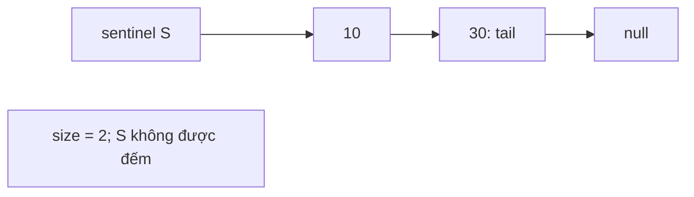
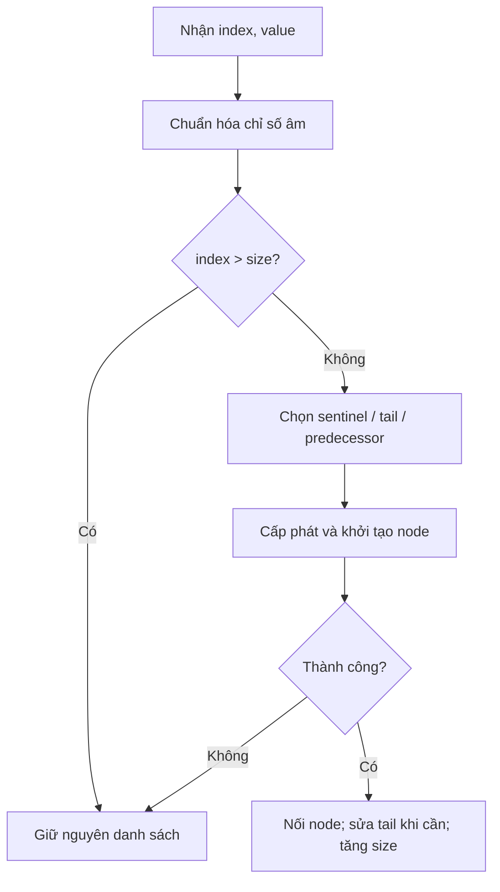
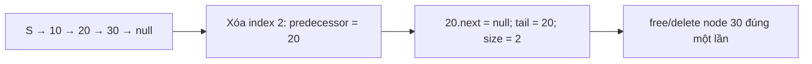

# Cornell Notes

## Topic: 707 — Thiết kế danh sách liên kết: sentinel, tail và quyền sở hữu bộ nhớ

## Date: 2026-10-24

<p align="center"><strong><em>"DO NOT JUST TALK ABOUT IT — SHOW IT"</em></strong></p>

## Abstract

Nghiên cứu cục bộ này nối ba lớp: hợp đồng API, bất biến cấu trúc và bằng chứng chạy thử. Sentinel thống nhất thao tác ở đầu danh sách; tail đưa append về O(1) nhưng thêm một bất biến cần sửa khi xóa node cuối. Tài liệu dùng vết thao tác cụ thể, lập luận cấp phát trước khi nối và câu hỏi thực hành để người học giải thích được vì sao chương trình đúng, thay vì chỉ nhìn một nhãn PASS.

## Learning Objectives

- **O1**: Tái dựng sentinel, size, tail và chứng minh bất biến sau chèn hoặc xóa.
- **O2**: Phân biệt quyền sở hữu bộ nhớ, thứ tự cập nhật con trỏ và bảo đảm khi cấp phát thất bại.
- **O3**: Giải thích đúng độ phức tạp, hợp đồng chỉ số và giới hạn của kiểm thử hữu hạn.
- **O4**: Chạy lại C11/C++17 và đối chiếu kết quả với bằng chứng, thay vì suy ra từ việc biên dịch thành công.

## Context and Constraints

Bài thực hành mới bổ sung vào nhóm contiguous versus linked structures của NeoLearning. Mục tiêu là tự xây dựng cấu trúc sở hữu node, thay vì chỉ sửa liên kết trên một danh sách đã được cấp phát như bài 206 hoặc 203. Tài liệu giải thích hợp đồng đã được duyệt của dự án; hành vi chỉ số âm là lựa chọn phòng vệ cục bộ, không phải một tuyên bố đã kiểm tra về đề LeetCode hiện hành. [S1] [S2] [S3]

- Chỉ dùng nguồn cục bộ đã đọc. Chính sách workflow là local-only: upstream not searched; không có bằng chứng nộp bài lên hệ thống chấm bên ngoài.
- C11 và C++17; singly linked list với sentinel nhúng trong đối tượng, size và tail; không dùng std::list làm phần cài đặt.
- Không thay đổi ba tệp bài thực hành từ tác vụ Curator. Note, câu hỏi và đáp án này được tạo riêng trong 00_note/NeoMind.
- Các kết quả thực thi hữu hạn không phải chứng nhận mọi đầu vào hay bằng chứng từ Valgrind, sanitizer hoặc công cụ phát hiện rò rỉ.

## Cue Column

- Q1 (O1, O2): Khi xóa node cuối cùng, tail phải trỏ vào đâu và vì sao không được để tail bằng con trỏ vừa free?
- Q2 (O1, O3): Tail giúp thao tác nào đạt O(1), và vì sao deleteAtIndex(size - 1) vẫn O(n)?
- Q3 (O2): Cần làm những gì trước khi đổi predecessor.next, và cấp phát thất bại phải để lại trạng thái nào?
- Q4 (O3, O4): Một log PASS với 2000 thao tác có chứng minh không rò rỉ và đúng với mọi đầu vào không?

## Main Notes

### Methods

[observed] Đọc yêu cầu REQ7 revision 3, thiết kế DES2, hai check plan CHK1/CHK2, note 206 và hai tệp triển khai 707 cuối cùng. Đối chiếu hợp đồng, dòng đời node và hướng dẫn chạy. Kết quả chạy được lấy từ evidence của Check Executor, không từ suy đoán của Curator. [S1] [S2] [S3] [S4] [S5] [S6] [S7] [S8]

### 1. Hình dung cấu trúc trước khi viết mã

[source-reported] Trạng thái rỗng là `S.next = null`, `size = 0`, `tail = &S`. `S` là sentinel nhúng, không phải node dữ liệu và không được free/delete riêng. Sau khi thêm 10 rồi 30: `S → 10 → 30 → null`, `size = 2`, `tail = node(30)`. Invariant cần giữ là: số node thực đi được từ `S.next` bằng size; chuỗi không có chu trình; tail là node cuối và tail.next bằng null. [S1] [S2]



### 2. Hợp đồng API và chỉ số

[source-reported] Chỉ số bắt đầu từ 0. `get(i)` với i âm hoặc i ≥ size trả -1; `deleteAtIndex(i)` ngoài miền này không làm gì. `addAtIndex(size, x)` nối cuối; index > size không làm gì; index âm được chuẩn hóa về 0 để thêm đầu. Kiểm tra âm trước khi ép sang size_t. Giá trị -1 vẫn được phép lưu, vì thế `get(i) == -1` không tự chứng minh i không hợp lệ. [S1] [S2]

| Tình huống | Kết quả hợp đồng |
|---|---|
| get(-1), get(size) | -1; không đổi cấu trúc |
| deleteAtIndex(-1), deleteAtIndex(size) | no-op |
| addAtIndex(-3, 9) | thêm 9 ở đầu theo hợp đồng cục bộ |
| addAtIndex(size, 9) | append |
| addAtIndex(size + 1, 9) | no-op |

C cung cấp `myLinkedListCreate/Get/AddAtHead/AddAtTail/AddAtIndex/DeleteAtIndex/Free`; C++ dùng lớp MyLinkedList với constructor, destructor và các phương thức tương ứng. C xử lý con trỏ đối tượng null theo hướng phòng vệ. Không có tuyên bố external judge chấp nhận mã. [S2] [S5] [S6]

### 3. Chiến lược chèn và xóa độc lập ngôn ngữ

[inferred] Muốn chèn tại index hợp lệ ở giữa, đi từ sentinel tới predecessor, lưu successor, cấp phát node mới, gán new.next = successor, rồi mới nối predecessor.next = new. Chỉ sau cấp phát thành công mới tăng size và sửa tail khi cần. Nhờ vậy lỗi cấp phát không làm mất chuỗi cũ. [S2] [S5] [S6]



[inferred] Xóa cần lưu victim = predecessor.next, nối predecessor.next = victim.next, sửa tail = predecessor nếu victim chính là tail, giảm size rồi giải phóng victim đúng một lần. Xóa node duy nhất khiến predecessor là sentinel; tail trở về &sentinel một cách tự nhiên. [S2] [S5] [S6]

### 4. Vết trạng thái cụ thể và quy tắc tail

[expected] Đây là vết tính tay theo hợp đồng, tách biệt với kết quả chạy bên dưới. [S1] [S2]

| Lệnh | Chuỗi node thực | size | tail |
|---|---|---:|---|
| tạo mới | [] | 0 | sentinel |
| addAtHead(10) | [10] | 1 | node 10 |
| addAtTail(30) | [10,30] | 2 | node 30 |
| addAtIndex(1,20) | [10,20,30] | 3 | node 30 |
| deleteAtIndex(2) | [10,20] | 2 | node 20 |
| deleteAtIndex(0) | [20] | 1 | node 20 |
| deleteAtIndex(0) | [] | 0 | sentinel |
| addAtTail(40) | [40] | 1 | node 40 |



### 5. Quyền sở hữu và lỗi dễ bị che khuất

[source-reported] Mỗi đối tượng sở hữu toàn bộ node thực của nó. C create có thể trả null; cấp phát node thất bại phải giữ nguyên nội dung, size và tail. C++ new có thể ném std::bad_alloc trước khi nối, nên trạng thái cũ còn nguyên. Destructor/free đi lặp, lưu next trước khi giải phóng; không dùng node sau free và không giải phóng sentinel nhúng. Bốn phép copy/move của C++ bị delete: sao chép tail đang trỏ vào sentinel của đối tượng nguồn sẽ tạo con trỏ sai ngay cả khi danh sách rỗng. [S2] [S5] [S6]

[inferred] Tail chỉ tăng tốc append. Xóa đuôi vẫn phải tìm predecessor bằng cách đi từ đầu: singly linked list không có liên kết ngược. Vòng kiểm tra invariant chỉ dùng trong test không được bị hiểu là chi phí của API ở bản triển khai thông thường. [S2] [S5] [S6]

### 6. Độ phức tạp, kiểm thử và ý nghĩa bằng chứng

[source-reported] Giả sử phép cấp phát có chi phí đơn vị trong mô hình thuật toán: [S2]

| Thao tác | Thời gian | Vì sao |
|---|---|---|
| addAtHead, addAtTail | O(1) | có sentinel và tail |
| addAtIndex ở 0 hoặc size | O(1) | dùng đường xử lý đầu/cuối |
| get / chèn giữa / xóa theo index | O(n) tệ nhất | phải đi tìm vị trí hoặc predecessor |
| destructor/free | O(n) | thăm và giải phóng từng node |
| node được sở hữu | O(n) bộ nhớ | một node cho mỗi giá trị |
| vùng tạm của thao tác | O(1) | vài con trỏ; dọn dẹp không đệ quy |

[observed] Check Executor đã chạy GCC/G++ 13.1.0 (MSYS2 Rev6) trên Windows: C11 thông thường đạt 7/7 ca với 2038 state checks; C11 LOCAL_TEST đạt 9/9 với 2043 checks, gồm lỗi cấp phát có điều khiển, và 1226 cấp phát/1226 giải phóng; C++17 LOCAL_TEST đạt 7/7 với 2038 checks và 1220 new/1220 delete. C++17 không LOCAL_TEST biên dịch thành object. Tất cả bước biên dịch -Wall -Wextra -Wpedantic không phát warning; executable check trả exit 0. Hai oracle API độc lập C và C++ chạy 2000 thao tác xác định cộng boundary/reuse, mỗi oracle đạt 2808 state checks. Sáu mục kiểm tra mã nguồn/tài liệu đều PASS ở evidence riêng. Đây là kết quả đã đọc từ log và records EVD0002/EVD0003 revision 2, không phải lần chạy của người học hoặc một chứng minh từ công cụ phát hiện rò rỉ. [S7] [S8]

[inferred] Biên dịch thành công kiểm tra cú pháp/kiểu và liên kết, không tự chứng minh kết quả API. Harness so sánh size, mọi giá trị, giới hạn số bước và tail; oracle độc lập so sánh hành vi với array/vector. Hai lớp bổ sung nhau nhưng không phải chứng minh mọi chuỗi thao tác, không quan sát mọi dạng rò rỉ hay mọi lịch lỗi bộ cấp phát. Không chạy external judge, sanitizer hoặc Valgrind trong evidence này. [S4] [S7] [S8]

### 7. Lệnh chạy lại và checklist thực hành

[expected] Chạy từ `D:\workspace\NeoLearning` trong PowerShell với GCC/MinGW đã có trên máy. Binaries đặt ngoài thư mục ba tệp nguồn, dùng thư mục temp duy nhất. PATH chỉ được bổ sung trong tiến trình PowerShell hiện tại để compiler tìm MinGW DLL; không đổi môi trường hệ thống. LOCAL_TEST bật harness và fault injection cần thiết. [S4] [S5] [S6]

```powershell
$env:PATH = "C:/msys64/mingw64/bin;" + $env:PATH
$src = "02_Software/02_Programming-Fundamentals/01_Algorithms-and-Data-Structures/02_practice/03_data_structures/02_contiguous_vs_linked_structures/707_design_linked_list"
$build707 = Join-Path $env:TEMP ("neomind-707-" + [guid]::NewGuid().ToString("N"))
New-Item -ItemType Directory -Path $build707 | Out-Null
& "C:/msys64/mingw64/bin/gcc.exe" -std=c11 -Wall -Wextra -Wpedantic -DLOCAL_TEST -static "$src/707_design_linked_list.c" -o "$build707/707-c.exe"
if ($LASTEXITCODE -ne 0) { throw "C compilation failed" }
& "$build707/707-c.exe"
if ($LASTEXITCODE -ne 0) { throw "C tests failed" }
& "C:/msys64/mingw64/bin/g++.exe" -std=c++17 -Wall -Wextra -Wpedantic -DLOCAL_TEST -static "$src/707_design_linked_list.cpp" -o "$build707/707-cpp.exe"
if ($LASTEXITCODE -ne 0) { throw "C++ compilation failed" }
& "$build707/707-cpp.exe"
if ($LASTEXITCODE -ne 0) { throw "C++ tests failed" }
& "C:/msys64/mingw64/bin/g++.exe" -std=c++17 -Wall -Wextra -Wpedantic -c "$src/707_design_linked_list.cpp" -o "$build707/707-submission.o"
if ($LASTEXITCODE -ne 0) { throw "C++ submission-interface compilation failed" }
```

Checklist: vẽ sentinel trước; viết hợp đồng chỉ số; kiểm tra cấp phát trước thay đổi; sửa tail khi xóa cuối; giải phóng đúng một lần; không copy/move; kiểm tra size và mọi giá trị; giữ exit code; đọc riêng câu hỏi rồi mới mở đáp án. Không coi lệnh in trên giấy là kết quả đã thực thi của người học.

### Results

[observed] Check Executor đã chạy GCC/G++ 13.1.0 (MSYS2 Rev6) trên Windows: C11 thông thường đạt 7/7 ca với 2038 state checks; C11 LOCAL_TEST đạt 9/9 với 2043 checks, gồm lỗi cấp phát có điều khiển, và 1226 cấp phát/1226 giải phóng; C++17 LOCAL_TEST đạt 7/7 với 2038 checks và 1220 new/1220 delete. C++17 không LOCAL_TEST biên dịch thành object. Tất cả bước biên dịch -Wall -Wextra -Wpedantic không phát warning; executable check trả exit 0. Hai oracle API độc lập C và C++ chạy 2000 thao tác xác định cộng boundary/reuse, mỗi oracle đạt 2808 state checks. Sáu mục kiểm tra mã nguồn/tài liệu đều PASS ở evidence riêng. Đây là kết quả đã đọc từ log và records EVD0002/EVD0003 revision 2, không phải lần chạy của người học hoặc một chứng minh từ công cụ phát hiện rò rỉ. Evidence gắn baseline tệp và check plan để tránh dùng log cũ cho mã đã đổi. [S7] [S8]

### Discussion

[inferred] Sentinel làm đơn giản hóa chèn/xóa đầu, tail giảm chi phí append, nhưng mỗi tối ưu thêm một bất biến cần giữ. Bài thực hành này dạy cách nối hợp đồng, mã nguồn và bằng chứng thực thi. Không có kết luận tối ưu tuyệt đối: nếu cần truy cập chỉ số ngẫu nhiên dày đặc, vector/array có locality và truy cập O(1) phù hợp hơn. Hợp đồng hiện tại không có concurrency hay iterator stability. [S1] [S2] Kết quả không có thử nghiệm ném std::bad_alloc hay chạy tới SIZE_MAX; các đường lỗi này được đọc từ mã, không gắn nhãn đã thực thi.

### Research Questions

### Q1: Khi xóa node cuối cùng, tail phải trỏ vào đâu và vì sao không được để tail bằng con trỏ vừa free?

Objectives: O1, O2

### Q2: Tail giúp thao tác nào đạt O(1), và vì sao deleteAtIndex(size - 1) vẫn O(n)?

Objectives: O1, O3

### Q3: Cần làm những gì trước khi đổi predecessor.next, và cấp phát thất bại phải để lại trạng thái nào?

Objectives: O2

### Q4: Một log PASS với 2000 thao tác có chứng minh không rò rỉ và đúng với mọi đầu vào không?

Objectives: O3, O4


## Demonstration

[expected] Dùng vết [] → [10] → [10,30] → [10,20,30] rồi xóa đuôi và xóa hết để kiểm tra phục hồi sentinel; sau đó append 40 phải tạo [40]. Lệnh argv bên dưới biên dịch và chạy harness C/C++ thật; đây là hướng dẫn tái lập, không tuyên bố người học đã chạy lại. [S1] [S2] [S7]

Argument vector (run from the project root):

```json
["C:/Program Files/nodejs/node.exe","-e","process.env.PATH='C:/msys64/mingw64/bin;'+process.env.PATH;const fs=require('node:fs'),p=require('node:path'),cp=require('node:child_process');const dir=fs.mkdtempSync(p.join(p.resolve('.neomind/runs'),'707-reader-'));const base=\"02_Software/02_Programming-Fundamentals/01_Algorithms-and-Data-Structures/02_practice/03_data_structures/02_contiguous_vs_linked_structures/707_design_linked_list\";for(const [exe,ext,flags,out]of [['C:/msys64/mingw64/bin/gcc.exe','c',['-std=c11','-Wall','-Wextra','-Wpedantic','-DLOCAL_TEST','-static'],'c.exe'],['C:/msys64/mingw64/bin/g++.exe','cpp',['-std=c++17','-Wall','-Wextra','-Wpedantic','-DLOCAL_TEST','-static'],'cpp.exe']]){const args=[...flags,p.join(base,'707_design_linked_list.'+ext),'-o',p.join(dir,out)];console.log(JSON.stringify([exe,...args]));let r=cp.spawnSync(exe,args,{stdio:'inherit',windowsHide:true});if(r.error)throw r.error;if(r.status!==0)process.exit(r.status??1);r=cp.spawnSync(p.join(dir,out),[],{stdio:'inherit',windowsHide:true});if(r.error)throw r.error;if(r.status!==0)process.exit(r.status??1);}console.log('Binaries: '+dir);"]
```

### Expected Result

[expected] Hai ngôn ngữ phải cùng tuân hợp đồng; mỗi trường hợp harness báo PASS, tổng thất bại bằng 0 và chương trình trả exit code 0. Lỗi phải trả nonzero. C++ không LOCAL_TEST cũng biên dịch được thành object.

### Observed Result

[observed] Check Executor đã chạy GCC/G++ 13.1.0 (MSYS2 Rev6) trên Windows: C11 thông thường đạt 7/7 ca với 2038 state checks; C11 LOCAL_TEST đạt 9/9 với 2043 checks, gồm lỗi cấp phát có điều khiển, và 1226 cấp phát/1226 giải phóng; C++17 LOCAL_TEST đạt 7/7 với 2038 checks và 1220 new/1220 delete. C++17 không LOCAL_TEST biên dịch thành object. Tất cả bước biên dịch -Wall -Wextra -Wpedantic không phát warning; executable check trả exit 0. Hai oracle API độc lập C và C++ chạy 2000 thao tác xác định cộng boundary/reuse, mỗi oracle đạt 2808 state checks. Sáu mục kiểm tra mã nguồn/tài liệu đều PASS ở evidence riêng. Đây là kết quả đã đọc từ log và records EVD0002/EVD0003 revision 2, không phải lần chạy của người học hoặc một chứng minh từ công cụ phát hiện rò rỉ.
Evidence: NM-11D03369-EVD-0002, NM-11D03369-EVD-0003

## Failure Cases

- Quên sửa tail khi xóa cuối gây use-after-free hoặc mất node ở lần append sau.
- Đếm sentinel vào size khiến index == size và điều kiện rỗng sai.
- Ép chỉ số âm sang unsigned trước khi kiểm tra làm lệch hợp đồng phòng vệ cục bộ.
- Đổi liên kết hoặc tăng size trước khi cấp phát thành công làm hỏng trạng thái trên đường lỗi.
- Đọc victim.next sau free hoặc free sentinel nhúng gây hành vi không xác định.
- Default copy/move sao chép con trỏ sở hữu hoặc tail tự tham chiếu sai đối tượng.
- Chỉ kiểm tra giá trị đầu/cuối có thể bỏ sót node mất giữa chuỗi; cần mọi giá trị và traversal có giới hạn.

## Practice

[Exercise](707-design-linked-list-practice.md) · [Answer](707-design-linked-list-answers.md)

Manual practice procedure (completion is not claimed):

1. Đóng tệp answers, vẽ node với địa chỉ ký hiệu S/A/B/C và ghi size/tail sau từng lệnh trước khi chạy.
2. Chạy lại hai harness bằng lệnh PowerShell trong note; ghi compiler identity, stdout và exit code của chính lần chạy.
3. Trả lời các câu P1–P4, đối chiếu với đáp án riêng và chỉ ra bất biến bị phá trong từng lỗi. Không sửa bài gốc chỉ để tạo lỗi.

## Summary

Danh sách liên kết đúng không chỉ là chuỗi giá trị đúng: sentinel, size, tail và quyền sở hữu phải nhất quán ở mọi đường đi. Cấp phát trước khi nối giúp giữ trạng thái khi thất bại; sửa tail khi xóa cuối giữ cho append O(1) an toàn. Hãy giải thích được vết con trỏ, hợp đồng chỉ số và giới hạn của bằng chứng trước khi xem PASS là hoàn thành việc học.

## Sources

- [S1] Yêu cầu 707 đã được cụ thể hóa, revision 3; record:NM-11D03369-REQ-0007; retrieved 2026-10-24T01:54:30.756Z; locator: acceptance_criteria và design_plan
- [S2] Thiết kế sentinel, size, tail và quyền sở hữu; record:NM-11D03369-DES-0002; retrieved 2026-10-24T01:54:30.756Z; locator: interface_contract, Ownership, Verification Implications
- [S3] Mẫu Cornell cục bộ của bài 206 Reverse Linked List; 02_Software/02_Programming-Fundamentals/01_Algorithms-and-Data-Structures/02_practice/03_data_structures/02_contiguous_vs_linked_structures/206_reverse_linked_list/206_note.md; retrieved 2026-10-24T01:54:30.756Z; locator: Cue Column, Notes Section, worked example và invariant; SHA-256: ce6b007e731c63711713fa0a0eb98abb6b459032d0639f88075b7980f88bd7c4
- [S4] Quy trình biên dịch, harness và oracle độc lập; record:NM-11D03369-CHK-0001; retrieved 2026-10-24T01:54:30.756Z; locator: command, Fixed procedure, Limits
- [S5] Triển khai và harness C11 của bài 707; 02_Software/02_Programming-Fundamentals/01_Algorithms-and-Data-Structures/02_practice/03_data_structures/02_contiguous_vs_linked_structures/707_design_linked_list/707_design_linked_list.c; retrieved 2026-10-24T01:54:30.756Z; locator: MyLinkedList API, LOCAL_TEST allocation hook và main harness; SHA-256: ba50cf7443453b0e06e6b0ca4ad14a79467872a75199b7c706a393e3d730f84c
- [S6] Triển khai và harness C++17 của bài 707; 02_Software/02_Programming-Fundamentals/01_Algorithms-and-Data-Structures/02_practice/03_data_structures/02_contiguous_vs_linked_structures/707_design_linked_list/707_design_linked_list.cpp; retrieved 2026-10-24T01:54:30.756Z; locator: MyLinkedList class, deleted copy/move và LOCAL_TEST harness; SHA-256: 6e1abbe7b7d566d7d18bdebb572514323d038b61cddec14826eb77b1a4dfecc9
- [S7] Bằng chứng chạy compiler, harness và oracle độc lập; record:NM-11D03369-EVD-0002; retrieved 2026-10-24T01:54:30.756Z; locator: result, baseline, execution/inspection log và receipt
- [S8] Bằng chứng kiểm tra cấu trúc mã nguồn và tài liệu; record:NM-11D03369-EVD-0003; retrieved 2026-10-24T01:54:30.756Z; locator: result, baseline, execution/inspection log và receipt
