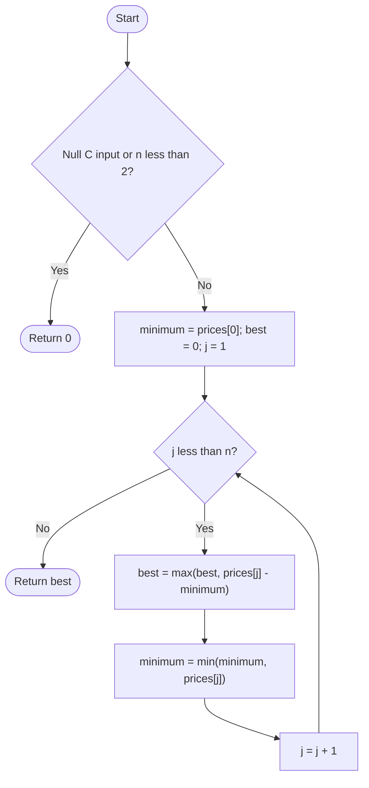
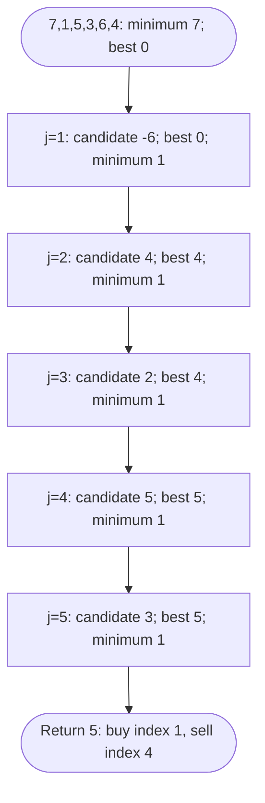
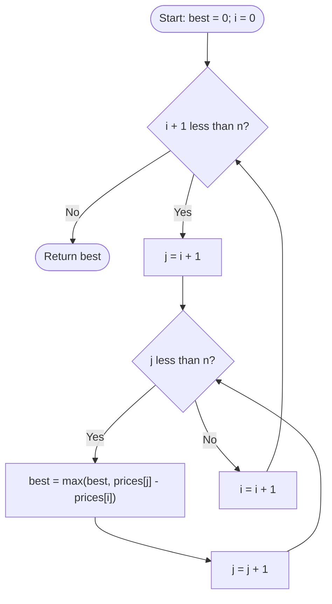
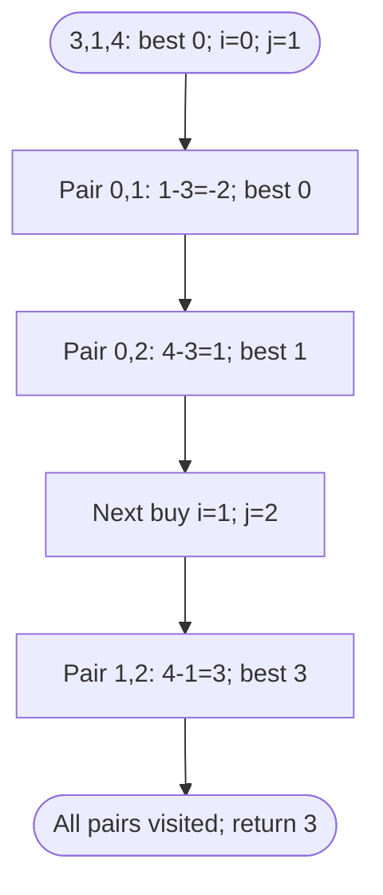

# Cornell Notes

## Topic: LeetCode - 121 - Best Time to Buy and Sell Stock

## Date: 01/11/2026

Source: https://leetcode.com/problems/best-time-to-buy-and-sell-stock/

---

### Problem Description

Each entry `prices[i]` is a stock's price on day `i`. Choose at most one purchase and one sale, with the purchase strictly before the sale. Return the largest possible profit; return zero if no profitable transaction exists. No short selling or multiple transactions.

| Input | Output | Explanation |
|---|---|---|
| `[7,1,5,3,6,4]` | `5` | Buy at 1 on day 2, sell at 6 on day 5 (one-based days) |
| `[7,6,4,3,1]` | `0` | Every later sale loses money; skip trading |

#### Constraints and Function Contract

- `1 <= prices.length <= 100000`; `0 <= prices[i] <= 10000`.
- C: `int maxProfit(int *prices, int pricesSize)`.
- C++: public `int Solution::maxProfit(std::vector<int>& prices)`.
- Return `max({0} union {prices[j] - prices[i] : 0 <= i < j < n})`.
- Borrow input without mutation, allocation, freeing, or ownership transfer. Caller retains storage.
- C requires a valid readable array of `pricesSize` elements when nonnull and size >= 2; dangling pointers and incorrect positive lengths are outside the contract. Defensive extension: null or any size < 2 returns zero before dereferencing.
- C++ requires a valid vector; empty and singleton vectors return zero as an extension.
- Values outside the stated price bounds are outside the contract; differences within bounds fit `int` (range `-10000..10000`). Neither API performs a separate validation pass over trusted judge input.
- Submit the C function or C++ includes/class without defining `LOCAL_TEST`. Defining it enables standalone assertion mains.

---

### Cue Column (Questions, Keywords, or Prompts)

| Cue | Recall target |
|---|---|
| What enforces chronology? | Buy minimum comes only from days strictly before sale day j |
| Why not global maximum minus minimum? | Maximum may occur before minimum |
| What prefix state is enough? | Cheapest prior price and best completed profit |
| Update order? | Evaluate sale first, then admit current price as a future buy |
| Why start best at zero? | Trading is optional |
| Why no prefix array? | Only the latest prefix minimum is needed |
| Invariant? | Minimum of prior days; optimum among prior ordered pairs |
| Baseline? | Enumerate every i < j; quadratic time |
| Array versus list? | Sequential scan needs no random access or rewiring |
| Bounds and ownership? | Safe int difference; input borrowed unchanged |

---

### Notes Section (Main Notes)

## Contiguous versus Linked Context

A C array or C++ vector stores prices contiguously: indexed reads are constant-time and a sequential scan usually has good cache locality. A linked representation could use the same two scalar states while following `next` in chronological order, also in O(n) time/O(1) auxiliary space. It lacks constant-time arbitrary indexing and may have poorer locality. Do not convert the input to a list: this task needs neither insertion nor node rewiring. Unlike neighboring pair-swap/list exercises, chronology is data order to preserve, not links to rearrange.

## Strategy A: Prefix-Minimum Scan (Implemented)

1. If fewer than two prices exist, return zero (C also guards null).
2. Set `minimum = prices[0]`, `best = 0`.
3. For sale day `j = 1..n-1`, evaluate `profit = prices[j] - minimum` and raise `best` if profitable.
4. Lower `minimum` with `prices[j]` for future sale days. Return `best` after the scan.

### Strategy A Flow



### Worked Example A

Zero-based indices for `[7,1,5,3,6,4]`:

| Sale j | Price | Minimum before sale | Candidate | Best after sale | Minimum after day |
|---|---|---|---|---|---|
| Initial day 0 | 7 | — | — | 0 | 7 |
| 1 | 1 | 7 | -6 | 0 | 1 |
| 2 | 5 | 1 | 4 | 4 | 1 |
| 3 | 3 | 1 | 2 | 4 | 1 |
| 4 | 6 | 1 | 5 | 5 | 1 |
| 5 | 4 | 1 | 3 | 5 | 1 |

### Strategy A Worked Example Flow



## Invariant and Correctness

At loop entry for day `j`, `minimum = min(prices[0..j-1])`, while `best` is zero or the largest profit of any ordered pair entirely within indices `0..j-1`.

- **Initialization:** at j=1, the prior prefix contains only day 0. Its minimum is prices[0]; there is no ordered pair, so best=0.
- **Preservation:** among all buys i<j, the minimum prior price maximizes `prices[j]-prices[i]`. Comparing that candidate with best accounts for every pair ending at j plus every earlier pair. Only then including prices[j] in minimum establishes the invariant for j+1. Equal minimum prices need no special handling.
- **Termination:** j increases until n. The invariant now covers every valid pair; best remains at least zero, so skipping an unprofitable trade is handled.
- **Complexity:** O(n) time, O(1) auxiliary space. Only scalar state; no prefix array or algorithmic allocation.

## Strategy B: Ordered-Pair Enumeration (Conceptual Baseline)

```text
best = 0
for i = 0 .. n-2:
    for j = i+1 .. n-1:
        best = max(best, prices[j] - prices[i])
return best
```

Every allowed transaction has exactly one pair i<j. The nested loops visit each once and keep the zero-clamped maximum, proving correctness directly. There are n(n-1)/2 candidates: O(n^2) time, O(1) auxiliary space. At n=100000 that is 4,999,950,000 comparisons: useful as a small-input oracle, not the submitted implementation. Prefix-minimum scanning compresses all earlier buys into one sufficient value for each sale.

### Strategy B Flow



### Worked Example B

For `[3,1,4]`, enumerate exactly `(0,1)`, `(0,2)`, `(1,2)`. Candidate profits are `-2`, `1`, `3`. Running best is `0`, `1`, `3`; result 3 buys at index 1, sells at index 2.

### Strategy B Worked Example Flow



## Common Failure Points

- Global `max-min` ignores chronology: `[7,1]` must yield 0, not 6.
- Sorting destroys day order and mutates borrowed input.
- Summing positive neighboring differences permits multiple trades (a different problem).
- Initializing best to a negative number wrongly forces a losing trade.
- Assuming the last day is the best sale misses `[1,8,2]`, whose answer is 7.
- Updating minimum before evaluating sale weakens the strict-prior-day invariant, even though same-day zero cannot improve this particular nonnegative answer. Keep proof and code aligned.
- Extra prefix arrays, copies, or linked-list conversion waste storage; local-test snapshots are test-only, not algorithmic state.

## Edge Cases to Test

| Case | Expected |
|---|---|
| `[5]` | 0 |
| `[2,2,2]` | 0 |
| `[1,2,3,4]` | 3 |
| `[7,6,4,3,1]` | 0 |
| `[3,1,1,5]` | 4; repeated minimum |
| `[1,8,2]` | 7; sale before final day |
| `[0,10000]` / `[10000,0]` | 10000 / 0 |
| C null, zero/negative size; C++ empty | 0; defensive extensions |
| 100000 prices `floor(i/10)` | 9999 |
| 100000 alternating 0/10000 | 10000 |

Guarded mains assert official examples, boundary/order cases and unchanged inputs. Independent testing should additionally enumerate arrays over `{0,1,2,3}`, lengths 1..7 (21844 arrays), compare a pair-enumeration oracle, verify no mutation, and exercise large analytical cases. These are test specifications, not execution claims.

## Sources and Local Assertion Checks

- [C11 implementation](121_best_time_to_buy_and_sell_stock.c)
- [C++17 implementation](121_best_time_to_buy_and_sell_stock.cpp)
- [Original problem](https://leetcode.com/problems/best-time-to-buy-and-sell-stock/)

From this exercise directory, in a POSIX-like shell with GCC tools on PATH:

```sh
build_dir=$(mktemp -d)
gcc -std=c11 -Wall -Wextra -Werror -pedantic -UNDEBUG -DLOCAL_TEST 121_best_time_to_buy_and_sell_stock.c -o "$build_dir/stock_c" && "$build_dir/stock_c"
g++ -std=c++17 -Wall -Wextra -Werror -pedantic -UNDEBUG -DLOCAL_TEST 121_best_time_to_buy_and_sell_stock.cpp -o "$build_dir/stock_cpp" && "$build_dir/stock_cpp"
rm -f "$build_dir/stock_c" "$build_dir/stock_cpp"
rmdir "$build_dir"
```

Windows PowerShell alternative, from the same directory; compiler directory is scoped to this session and restored:

```powershell
$build = Join-Path ([IO.Path]::GetTempPath()) ([guid]::NewGuid().ToString())
$oldPath = $env:PATH
New-Item -ItemType Directory -Path $build | Out-Null
try {
    $env:PATH = 'C:\msys64\mingw64\bin;' + $env:PATH
    & 'C:/msys64/mingw64/bin/gcc.exe' -std=c11 -Wall -Wextra -Werror -pedantic -UNDEBUG -DLOCAL_TEST 121_best_time_to_buy_and_sell_stock.c -o "$build/stock_c.exe"
    if ($LASTEXITCODE -ne 0) { throw 'C build failed' }
    & "$build/stock_c.exe"
    if ($LASTEXITCODE -ne 0) { throw 'C assertions failed' }
    & 'C:/msys64/mingw64/bin/g++.exe' -std=c++17 -Wall -Wextra -Werror -pedantic -UNDEBUG -DLOCAL_TEST 121_best_time_to_buy_and_sell_stock.cpp -o "$build/stock_cpp.exe"
    if ($LASTEXITCODE -ne 0) { throw 'C++ build failed' }
    & "$build/stock_cpp.exe"
    if ($LASTEXITCODE -ne 0) { throw 'C++ assertions failed' }
} finally {
    $env:PATH = $oldPath
    Remove-Item -LiteralPath $build -Recurse -Force
}
```

Keep binaries in disposable OS temporary storage, not the curriculum. Assertions require `-UNDEBUG`. Local assertions do not replace independent oracle checks or review. No execution results are claimed here.

---

### Summary Section (Summary of Notes)

For each sale, only the cheapest strictly earlier buy matters. Evaluate profit, retain the best nonnegative result, then update the prefix minimum. The invariant proves a single O(n)-time/O(1)-space scan optimal without mutating input. Ordered-pair enumeration is a simple O(n^2) reference. Chronology, not global extrema, distinguishes the problem; contiguous storage supports an efficient sequential read, while linked conversion adds no value.
