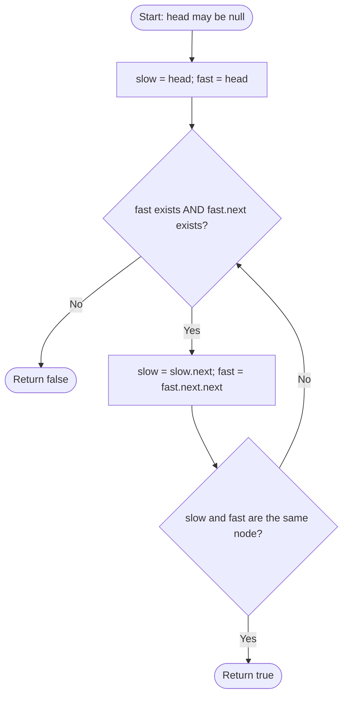
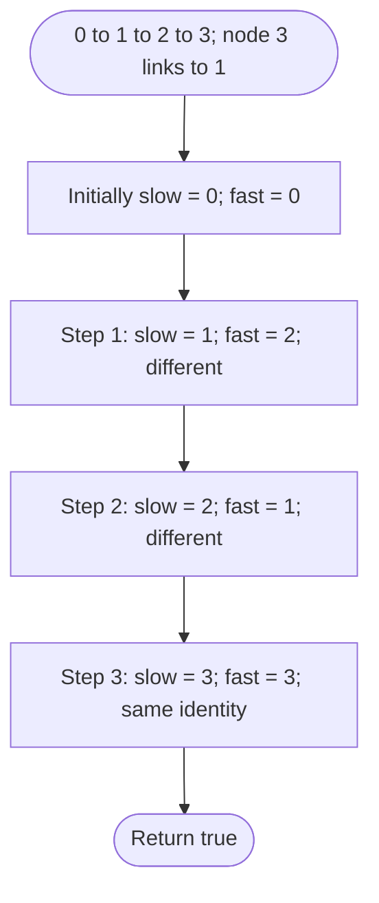
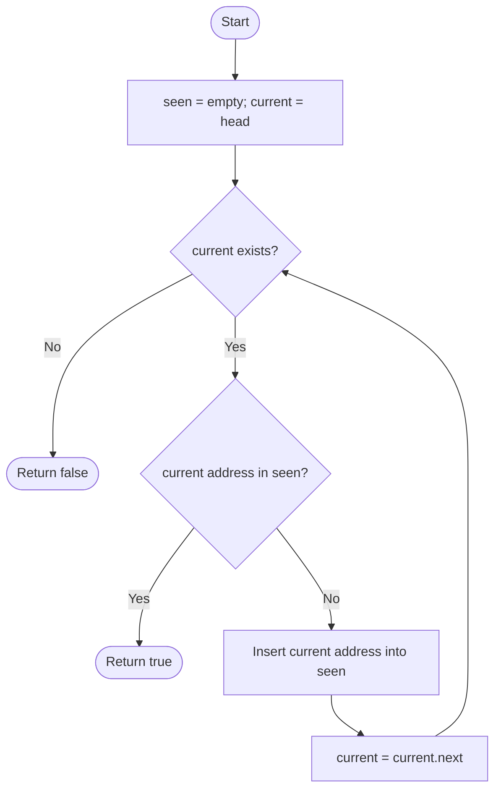
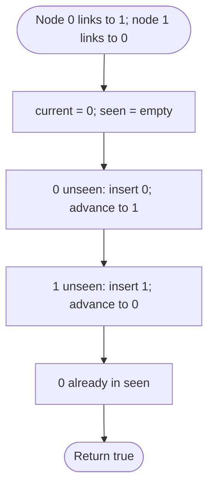

# Cornell Notes

## Topic: Leetcode - 141 - Linked List Cycle

## Date: 01/11/2026

Source: https://leetcode.com/problems/linked-list-cycle/

---

<p align="center"><strong><em>"DO NOT JUST TALK ABOUT IT — SHOW IT"</em></strong></p>

---

### Problem Description

Given `head`, the head of a singly linked list, return `true` if the list contains a cycle; otherwise return `false`. A cycle exists when following `next` repeatedly can revisit the **same node**.

`pos` describes the zero-based node index to which the tail connects. It is construction metadata, **not a function argument**. `pos = -1` means the tail points to null. Equal values do not imply equal nodes.

#### Example 1

```text
Input: head = [3,2,0,-4], pos = 1
Links: index 0 -> 1 -> 2 -> 3 -> 1 -> ...
Output: true
```

The tail reconnects to the second node, not to a node selected by its value.

#### Example 2

```text
Input: head = [1,2], pos = 0
Links: index 0 -> 1 -> 0 -> ...
Output: true
```

#### Example 3

```text
Input: head = [1], pos = -1
Links: index 0 -> null
Output: false
```

#### Constraints

- Number of nodes: `0..10000`.
- Node values: `-100000..100000`.
- `pos` is `-1` or a valid node index; an empty list permits only `-1`.
- Follow-up: solve with `O(1)` auxiliary space.

#### Function Contract

- **C:** `bool hasCycle(struct ListNode *head)`.
- **C++:** `bool Solution::hasCycle(ListNode *head)`.
- **Input:** null or borrowed live nodes whose links are null or point to valid live nodes. Dangling pointers are not supported; the caller must maintain node lifetimes.
- **Output:** cycle existence, not the cycle entry or length.
- **Mutation:** no writes to node values or links; original order/topology unchanged.
- **Ownership:** no allocation, deallocation, copying, or ownership transfer. The caller retains every node.
- The local files define `ListNode` for standalone compilation; omit that definition when submitting to LeetCode, which supplies it. `LOCAL_TEST` alone enables each assertion-based `main`.

---

### Cue Column (Questions, Keywords, or Prompts)

- How does Floyd's fast/slow pattern differ from finding the middle in problem 876?
- Why compare pointers rather than values?
- Why compare only after moving?
- Why must `fast` be checked before `fast->next`?
- What invariant describes distance traveled?
- Why must two speeds meet inside a cycle?
- What does `pos` mean, and why is it absent from the API?
- What does a visited-node set cost?
- How do linked traversal and contiguous indexed access differ?

---

### Notes Section (Main Notes)

## Mindset First (language-agnostic)

Detect repeated **identity**, not repeated data. Naive traversal until null never finishes on a cycle. Use either two traversal speeds or a set of node addresses. Production solutions use Floyd: `O(n)` time, `O(1)` auxiliary space, where `n` is the number of distinct reachable nodes.

In a contiguous array, index `i` gives direct `O(1)` access by address arithmetic. A linked list need not occupy adjacent addresses; reaching its ith node requires following links, `O(i)`. The indices used here label construction/storage only; the algorithm cannot jump to `pos` or use physical adjacency. Test arrays are storage conveniences, not algorithm assumptions.

## Strategy A: Floyd's Fast and Slow Pointers

1. Initialize `slow = head`, `fast = head`.
2. While `fast` and `fast->next` exist, advance `slow` one link and `fast` two links.
3. After advancing, if `slow == fast`, return `true`.
4. When the guard fails, return `false`.

Compare addresses, never `slow->val == fast->val`. Initial pointer equality is not evidence: both start at `head`, even for an acyclic list.

### Strategy A Flow



## Worked Example A: Floyd on `[3,2,0,-4]`, `pos = 1`

Indices identify nodes; the cycle is `1,2,3,1,...`.

| Completed iterations | slow index | fast index | Decision |
|---|---|---|---|
| 0 | 0 | 0 | Do not compare yet |
| 1 | 1 | 2 | Different |
| 2 | 2 | 1 | Different |
| 3 | 3 | 3 | Same node: true |

### Strategy A Worked Example Flow



## Pointer Movement Invariant and Correctness

After `k` completed iterations, `slow` has followed `k` links and `fast` has followed `2k` links from `head`; the original graph is unchanged. A two-link move is safe because the guard proves both `fast` and its successor exist. On an acyclic list, the slower pointer cannot run out before the faster pointer, so its one-link move is safe too.

- **Acyclic case:** all reachable nodes are distinct until null. For `k > 0`, positions at distances `k` and `2k` cannot be the same live node. Eventually `fast` is null or its successor is null; return false.
- **Cyclic case:** let the prefix length be `mu` and cycle length be `lambda >= 1`. Once both pointers are inside the cycle, their relative offset changes by one modulo `lambda` each iteration. Within at most `lambda` further iterations the offset is zero, so they meet. For `mu = 0`, comparing after movement still finds a meeting within `lambda` steps.
- **Termination/complexity:** `O(mu + lambda) = O(n)` time for a cycle; `O(n)` time without one. Only two pointer variables are needed: `O(1)` auxiliary space. No node is modified.

Benefits: constant space, one traversal process, no allocation failures. Trade-off: less intuitive than explicit history; finding the entry requires an additional phase, not requested here. A meeting node is not necessarily the entry (example A meets at index 3, entry 1).

## Strategy B: Visited-Node Identity Set

1. Set `current = head`; start an empty set of node addresses.
2. While `current` exists, return true if its address is already present.
3. Otherwise insert its address, then advance one link.
4. Return false at null.

Correctness: the set contains exactly the previously visited identities. Revisiting one means the deterministic next-link path repeats forever. If null is reached, no identity repeated, so no cycle exists.

With a hash set: expected `O(n)` time, `O(n)` auxiliary space (hash worst-case time can be `O(n²)`). C++ can use `std::unordered_set<ListNode *>`; C would need a pointer-set implementation. A linear list of seen addresses is simpler but costs `O(n²)` time. This alternative is conceptual; paired source files implement only Floyd.

Benefits: direct explanation and easy repeat identification. Trade-offs: extra memory, hashing, allocation handling; does not satisfy the constant-space follow-up. Store addresses, not node values.

### Strategy B Flow



## Worked Example B: Visited Set on `[1,2]`, `pos = 0`

| Visit | Current index | Seen before visit | Action |
|---|---|---|---|
| 1 | 0 | `{}` | Insert 0, advance to 1 |
| 2 | 1 | `{0}` | Insert 1, advance to 0 |
| 3 | 0 | `{0,1}` | Repeated identity: true |

### Strategy B Worked Example Flow



For comparison, an acyclic duplicate-valued list `[7,7]`, `pos = -1`, visits two different addresses and then null: false. Floyd makes one move (`slow = index 1`, `fast = null`) then exits: also false.

## Common Failure Points (all languages)

- Comparing the initially equal pointers before any move: false positives.
- Comparing values: different nodes can both contain 7.
- Dereferencing `fast->next` before checking `fast`: null access.
- Moving both pointers at the same speed: no useful relative progress.
- Traversing to null to compute length first: hangs on cyclic input.
- Cutting links or marking values as visited: violates immutability.
- Returning the entry node or meeting node instead of a boolean.
- Treating `pos` as a parameter or using it to bypass traversal.
- Freeing or printing a cyclic list by unbounded traversal: infinite loop or double free. Manage test storage independently of links.

## Edge Cases to Test

| Case | Input / construction | Expected |
|---|---|---|
| Empty | `[]`, `pos = -1` | false |
| Singleton | `[42]`, `pos = -1` | false |
| Self-loop | `[42]`, `pos = 0` | true |
| Two nodes, acyclic | `[7,7]`, `pos = -1` | false despite equal values |
| Two-node cycle | `[1,2]`, `pos = 0` | true |
| Tail self-loop | `[1,2]`, `pos = 1` | true |
| Odd/even acyclic | 3 or 4 nodes, `pos = -1` | false |
| Nonzero entry | `[3,2,0,-4]`, `pos = 1` | true |
| Boundary values | `[-100000,100000]`, `pos = -1` or `0` | false / true |
| Maximum length | 10000 nodes, `pos = -1`, `0`, or `9999` | false / true / true |

For independent verification, enumerate lengths `0..64`, every legal entry including `-1`, then the three maximum-length constructions above. Use a repeated-index history oracle, not a second Floyd implementation. Snapshot every owned node's value/link by storage index before and after the call; never snapshot by cyclic traversal. These are verification requirements, not a claim of executed tests.

## Implementation Checklist

- [ ] Initialize both pointers at `head`; accept null.
- [ ] Short-circuit `fast` before inspecting `fast->next`.
- [ ] Move one and two links; compare identity after the moves.
- [ ] Return true on meeting; false on termination.
- [ ] Preserve every node value, link, and ownership.
- [ ] Check null, self-loop, duplicate values, odd/even lists, each entry position.
- [ ] Confirm `O(n)` time and `O(1)` space.
- [ ] Build/run both guarded assertion suites with assertions enabled.

## Local Assertion Checks

Run from this exercise directory with C11/C++17 compilers available. Output paths below suit a POSIX-like shell; use an appropriate temporary directory on other platforms. No binary belongs in the exercise folder.

```sh
gcc -std=c11 -Wall -Wextra -Werror -pedantic -UNDEBUG -DLOCAL_TEST 141_linked_list_cycle.c -o /tmp/141_cycle_c
/tmp/141_cycle_c
g++ -std=c++17 -Wall -Wextra -Werror -pedantic -UNDEBUG -DLOCAL_TEST 141_linked_list_cycle.cpp -o /tmp/141_cycle_cpp
/tmp/141_cycle_cpp
```

These assertions exercise the actual production APIs; they do not replace the independent exhaustive oracle.

---

### Summary Section (Summary of Notes)

Floyd advances one pointer one link and another two links, comparing node identity only after movement. Acyclic input exhausts the fast pointer; a cycle forces the relative offset to become zero. Return a boolean in `O(n)` time and `O(1)` space without changing or owning the list. A visited-address set offers a more explicit alternative at `O(n)` space. `pos` describes construction, not an API input; repeated values alone never prove a cycle.
