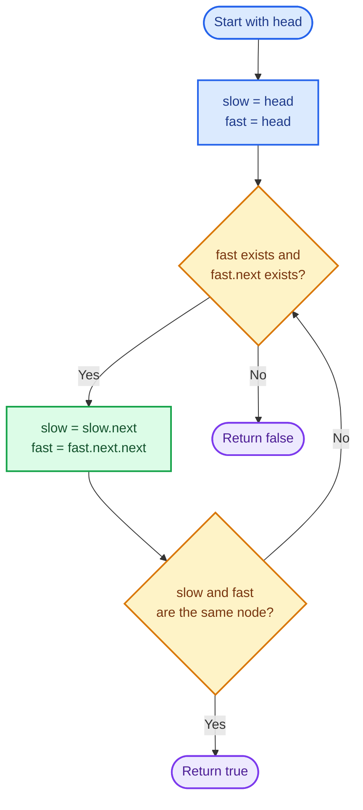
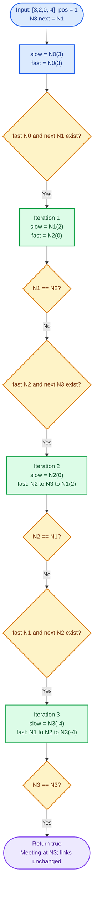
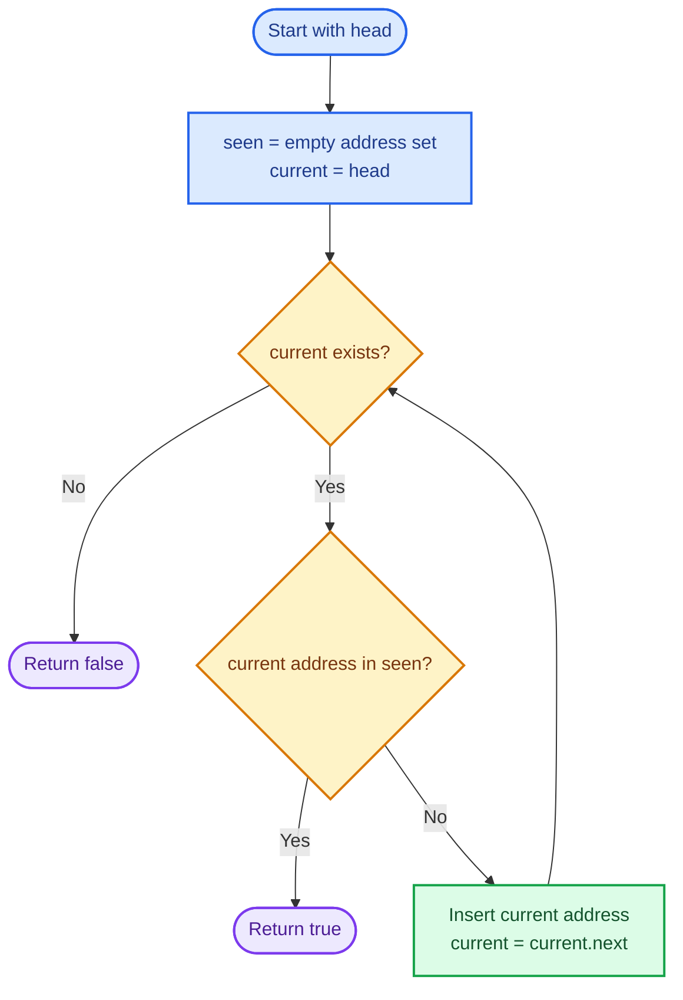
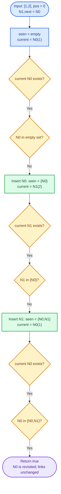

# Cornell Notes

## Topic: Leetcode - 141 - Linked List Cycle

## Date: 11/10/2026

---

<p align="center"><strong><em>"DO NOT JUST TALK ABOUT IT — SHOW IT"</em></strong></p>

---

### Problem Description

Starting at `head`, determine whether following `next` revisits a node. Return a boolean. `pos` describes the tail's destination in test fixtures; it is **not a function parameter**. Problem facts below come from the [official LeetCode statement](https://leetcode.com/problems/linked-list-cycle/description/).

#### Example 1

```text
Input:  head = [3,2,0,-4], pos = 1
Output: true
```

The last node points to node index `1`.

#### Example 2

```text
Input:  head = [1,2], pos = 0
Output: true
```

The last node points to the head.

#### Example 3

```text
Input:  head = [1], pos = -1
Output: false
```

The last link is null.

#### Constraints

- Node count `n` is in `[0, 10000]`.
- `-100000 <= Node.val <= 100000`.
- `pos` is `-1` or a valid zero-based node index.
- The follow-up requests constant auxiliary memory.

#### Function Contract

- **Input:** `head` points to a valid singly linked structure, possibly cyclic; null represents an empty list. Every non-null link points to a live node.
- **Output:** `true` exactly when a cycle is reachable from `head`; otherwise `false`. No cycle-entry pointer is returned.
- **Mutation:** No node values or `next` links change.
- **Ordering:** The existing link order remains unchanged.
- **Ownership or memory:** The caller owns the nodes. The solution neither allocates nor frees nodes and retains no pointers after returning.
- **Judge interfaces:** C uses `bool hasCycle(struct ListNode *head)`; C++ uses `bool Solution::hasCycle(ListNode *head)`. The judge supplies `ListNode`; local definitions and checks are guarded by `LOCAL_TEST`.

---

### Cue Column (Questions, Keywords, or Prompts)

- How does the fast/slow pattern from exercise `876` change when a list might loop?
- Why does a meeting after movement prove a cycle?
- Why is initial pointer equality insufficient?
- What does relative movement modulo the cycle length prove?
- Why must `fast` be checked before `fast->next`?
- Why do repeated values say nothing about repeated node identities?
- What are the costs of Floyd versus remembering visited addresses?
- How can a fixture release storage without following cyclic links?

---

### Notes Section (Main Notes)

## Mindset First (language-agnostic)

- Picture: a chain either ends at null or enters a loop. In a loop, a faster runner eventually catches a slower runner.
- Pattern: fast and slow pointers, comparing **node identity**, not value.
- Invariant: after `k` completed iterations, `slow` has followed `k` links and `fast` has followed `2k` links along the original structure, possibly reaching null. No links or values change.
- Target time: `O(n)`, where `n` counts distinct reachable nodes.
- Target auxiliary space: `O(1)`; the boolean output also needs constant space.
- Optimality: an unseen tail link can distinguish a long chain from a cycle, so worst-case detection requires linear work. Two pointers avoid storing the visited prefix.

## Strategy A: Floyd's Fast and Slow Pointers

- Core idea: move `slow` one link and `fast` two, then check whether they point to the same node.
- Algorithm:
  1. Set `slow = head` and `fast = head`.
  2. While both `fast` and `fast.next` exist, move `slow` once and `fast` twice.
  3. After those moves, return `true` if `slow == fast`.
  4. If the loop guard fails, return `false`.
- Correctness: a terminating chain gives distinct traversal positions after each positive iteration, so no meeting occurs. In a cycle, once both runners are inside, their relative position advances by one modulo the cycle length and must reach zero. The detailed invariant below also explains safe dereferencing.
- Complexity: `O(n)` time and `O(1)` auxiliary space.
- Benefits: no allocation, no mutation, no size-dependent storage or recursion.
- Trade-offs: movement and comparison order must be correct; this function detects existence only.

### Strategy A Flow



## Worked Example A: Floyd on `[3,2,0,-4], pos = 1`

Label node identities `N0(3)`, `N1(2)`, `N2(0)`, and `N3(-4)`; links are `N0 -> N1 -> N2 -> N3 -> N1`.

### Strategy A Worked Example Flow



## Strategy B: Set of Visited Node Addresses

- Core idea: remember every distinct node address encountered while following `next`.
- Algorithm:
  1. Initialize an empty address set and `current = head`.
  2. While `current` exists, return `true` if its address is already in the set.
  3. Otherwise insert that address and advance `current = current.next`.
  4. Return `false` upon reaching null.
- Invariant: before each membership check, the set contains exactly the distinct nodes visited earlier. A repeated address therefore proves a cycle; null proves termination.
- Complexity: expected `O(n)` time with expected constant-time hash membership/insertion, and `O(n)` auxiliary space. Hash collisions can make worst-case time `O(n^2)`; an ordered set gives `O(n log n)` time instead.
- Benefits: directly expresses the definition; can also identify the first revisited node.
- Trade-offs: needs size-dependent storage and allocation, so it does not satisfy the constant-memory follow-up. The local C/C++ solutions implement Strategy A; this alternative is explanatory.

### Strategy B Flow



## Worked Example B: Visited Addresses on `[1,2], pos = 0`

Use identities `N0(1)` and `N1(2)` with `N0 -> N1 -> N0`; the set stores these identities rather than `1` and `2`.

### Strategy B Worked Example Flow



## Movement Invariant and Termination

Let `mu` be the number of links before the cycle entry, and `lambda` the cycle length. For a cyclic structure, `n = mu + lambda` counts its distinct reachable nodes.

After `k` iterations the runners have traveled `k` and `2k` links. Once `k >= mu`, both are inside the loop. Their offsets from the entry are `(k - mu) mod lambda` and `(2k - mu) mod lambda`; their relative offset is `k mod lambda`. Each next iteration adds one modulo `lambda`, so they meet within at most `lambda` further iterations. Total work is `O(mu + lambda) = O(n)`.

In an acyclic structure, distinct positive traversal distances cannot denote the same node, and `fast` eventually becomes null or reaches a node with null `next`. Short-circuit `fast && fast->next` makes the two-link read safe. `slow` can also take its next step: it has traveled only half the distance, so it cannot already be past the last node while `fast` can still advance.

Initial equality at `k = 0` occurs for every input and proves nothing. Comparing after movement handles an acyclic singleton as `false` and a singleton pointing to itself as `true`. A meeting node is not necessarily the entry: Example 1 meets at `N3`, while the entry is `N1`.

## Common Failure Points (all languages)

- Comparing pointers before the first movement and returning `true` for every nonempty list.
- Comparing `slow.val` and `fast.val`; equal values can belong to distinct acyclic nodes.
- Reading `fast->next` before proving `fast` exists, or taking two steps without the guard.
- Moving both pointers at the same speed, which supplies no relative progress.
- Traversing until null to count nodes; a cycle prevents termination.
- Marking or breaking links despite the nonmutation contract.
- Returning a meeting node or cycle entry when the required result is boolean.
- Treating `pos` as a second function parameter.
- Cleaning up a cyclic fixture by repeatedly following `next`.
- Growing a node vector after linking, which can invalidate stored addresses.

## Edge Cases to Test

| Case | Input | Expected | Notes |
|------|-------|----------|-------|
| Empty | `[], pos=-1` | `false` | Guard fails without dereference. |
| Acyclic singleton | `[1], pos=-1` | `false` | Initial equality must be ignored. |
| Self-loop | `[1], pos=0` | `true` | One iteration meets at the same node. |
| Two-node chain | `[1,2], pos=-1` | `false` | Fast becomes null after one iteration. |
| Two-node cycle | `[1,2], pos=0` | `true` | Both nodes form the loop. |
| Tail self-loop | `[1,2], pos=1` | `true` | A noncyclic prefix precedes a length-one loop. |
| Interior entry | `[3,2,0,-4], pos=1` | `true` | Official prefix-plus-cycle example. |
| Repeated values | `[7,7,7,7], pos=-1` | `false` | Value equality is not node equality. |
| Boundary values | `[-100000,0,100000], pos=1` | `true` | Values never influence detection. |
| All small tail choices | Lengths `0..32`; each legal `pos` | `pos >= 0` | `561` constructed cases per language. |
| Maximum size | `10000` nodes; `pos=-1,0,5000,9999` | `false,true,true,true` | Acyclic, head, interior, and tail-entry boundaries. |

## Why Floyd's Fast and Slow Pointers is Interview Gold

1. Two pointers achieve optimal worst-case linear time and constant auxiliary space.
2. The relative offset gives a compact correctness and termination proof.
3. The safe loop guard and comparison order demonstrate careful pointer reasoning.
4. It extends the fast/slow pattern learned in [exercise 876](../876_middle_of_the_linked_list/876_note.md); cycle handling also matters before using terminating-chain operations such as [exercise 206](../206_reverse_linked_list/206_note.md).

## Local Implementation and Verification

- [C solution](141_linked_list_cycle.c) and [C++ solution](141_linked_list_cycle.cpp) use the same Floyd contract.
- Under `LOCAL_TEST`, both harnesses call their actual solution and run `574` cases: nine named cases, `561` exhaustive small fixtures, and four maximum-size cases. Every case verifies the returned status and that all node values and links match snapshots.
- Expected answers derive from the constructed tail destination, independently of Floyd. C owns one contiguous node allocation; C++ sizes its node vector before linking. Cleanup uses those owners directly, never cyclic traversal. This storage choice belongs to the harness; the algorithm works with arbitrary valid node addresses.
- Harnesses exit nonzero on a failed result or mutation. Test storage is `O(n)`, separate from the solution's `O(1)` auxiliary-space claim.

From this exercise folder, use PowerShell with MinGW GCC/G++ available at the installed path below. Build outputs go to a fresh temporary directory:

```powershell
$env:PATH = 'C:/msys64/mingw64/bin;' + $env:PATH
$buildDir = Join-Path ([System.IO.Path]::GetTempPath()) ('leetcode141-' + [guid]::NewGuid().ToString('N'))
New-Item -ItemType Directory -Path $buildDir | Out-Null
gcc -std=c11 -Wall -Wextra -Werror -pedantic -DLOCAL_TEST 141_linked_list_cycle.c -o "$buildDir/141_c_test.exe"
if ($LASTEXITCODE -ne 0) { throw 'C build failed' }
& "$buildDir/141_c_test.exe"
if ($LASTEXITCODE -ne 0) { throw 'C checks failed' }
g++ -std=c++17 -Wall -Wextra -Werror -pedantic -DLOCAL_TEST 141_linked_list_cycle.cpp -o "$buildDir/141_cpp_test.exe"
if ($LASTEXITCODE -ne 0) { throw 'C++ build failed' }
& "$buildDir/141_cpp_test.exe"
if ($LASTEXITCODE -ne 0) { throw 'C++ checks failed' }
```

For judge use, leave `LOCAL_TEST` undefined and use the source with the judge-provided `ListNode` definition. There is no local `main` or fixture code in that mode. Compiling the raw source without `LOCAL_TEST` outside the judge requires a wrapper that defines `ListNode` **before** including the source.

## Implementation Checklist

- [x] Initialize both pointers at `head` and compare only after moving.
- [x] Check `fast` before reading `fast->next`; advance one and two links.
- [x] Compare node addresses and return a boolean.
- [x] Preserve all values, links, and caller ownership.
- [x] Call the actual C function and C++ method in local checks.
- [x] Cover null, singleton, two-node, repeated-value, all small tail positions, value limits, and `10000`-node fixtures.
- [x] Release fixture storage independently of its links.
- [x] Keep local node definitions inside `LOCAL_TEST` for judge compatibility.
- [x] Distinguish solution `O(1)` storage from harness and visited-set `O(n)` storage.

---

### Summary Section (Summary of Notes)

Cycle detection is a node-identity problem. Floyd maintains one-step and two-step traversal distances; after movement, equal pointers prove a cycle. Inside a loop their relative offset advances by one modulo its length, guaranteeing a meeting. Null ends an acyclic traversal. The implemented method uses `O(n)` time and `O(1)` auxiliary space without changing the list. Null and acyclic singleton inputs return `false`; a self-loop returns `true`. A visited-address set offers a direct alternative with expected `O(n)` time and `O(n)` storage.
