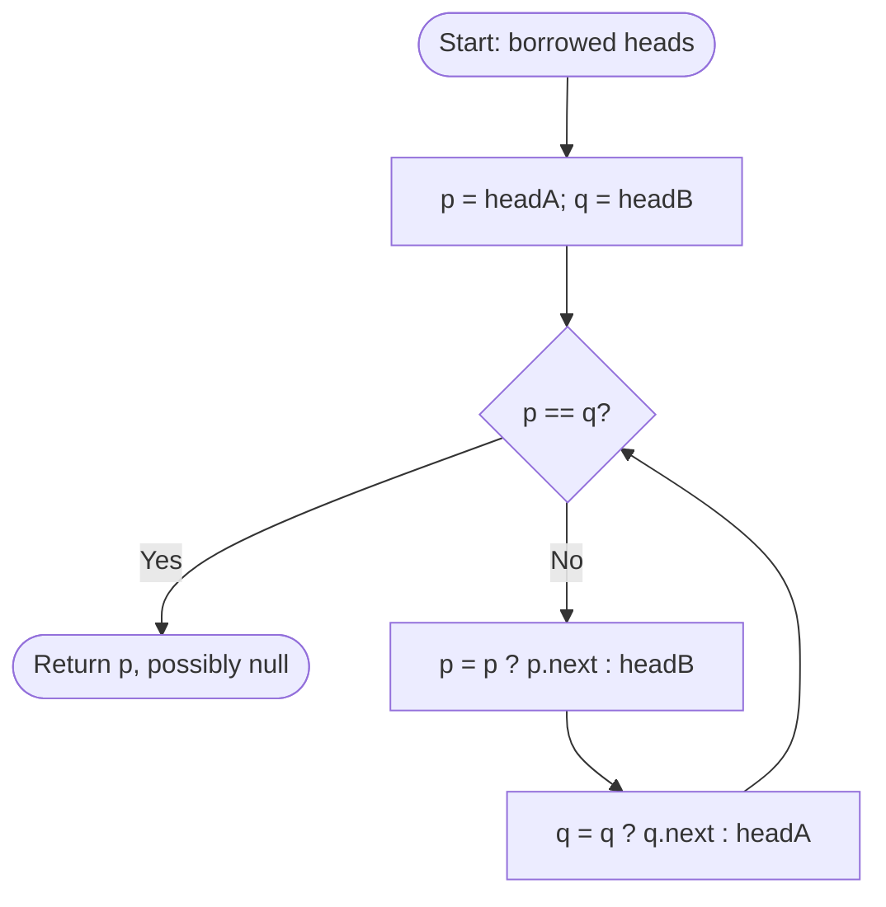
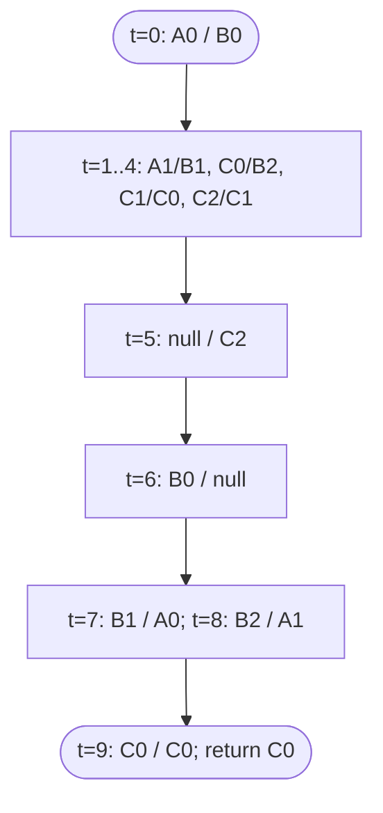
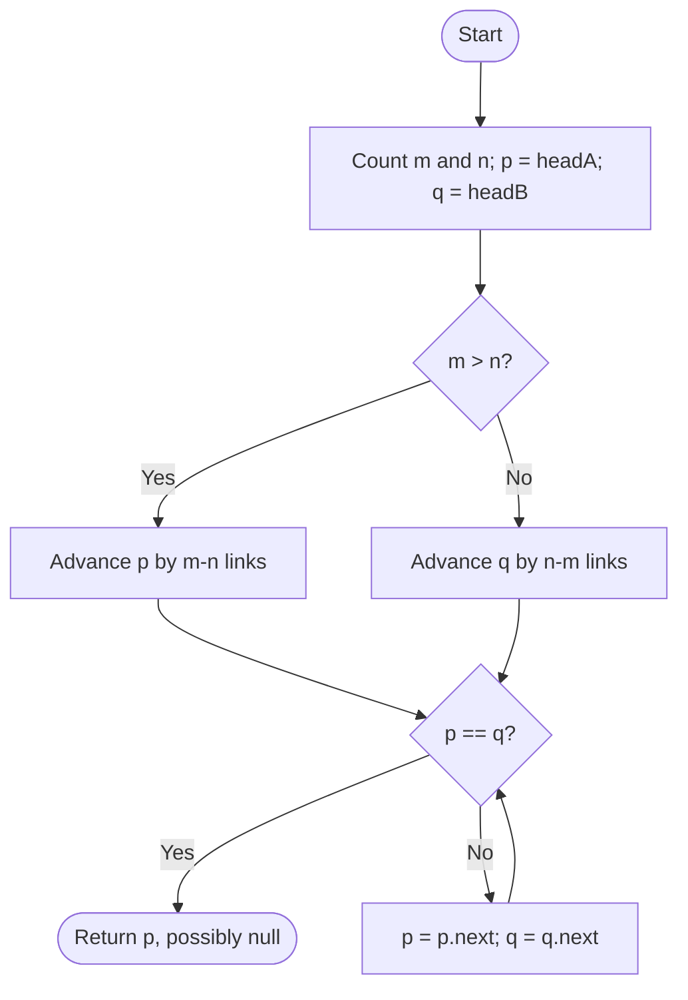
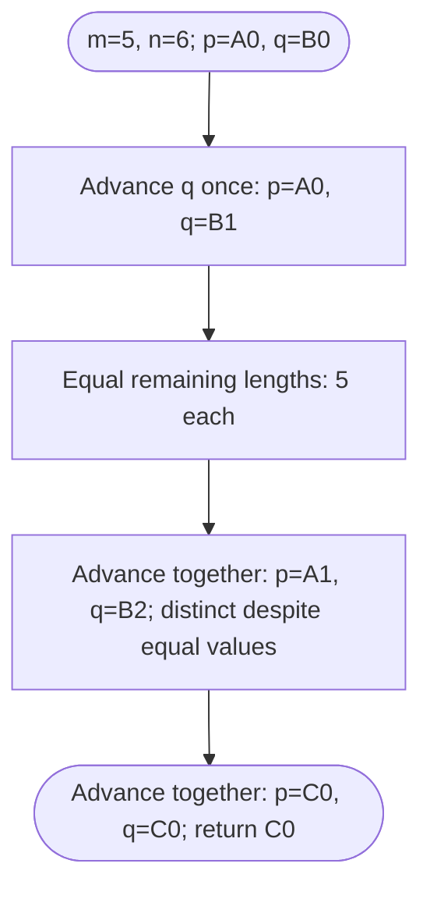

# Cornell Notes

## Topic: LeetCode - 160 - Intersection of Two Linked Lists

## Date: 01/11/2026

Source: https://leetcode.com/problems/intersection-of-two-linked-lists/

---

### Problem Description

Given `headA` and `headB`, the heads of two singly linked lists, return the node at which they intersect. Return null if they do not intersect. Intersection means **the same node object/address**, not equal values. The lists contain no cycles. Preserve their original structure after returning.

#### Official examples

| `intersectVal` | `listA` | `listB` | `skipA`, `skipB` | Result |
|---|---|---|---|---|
| 8 | `[4,1,8,4,5]` | `[5,6,1,8,4,5]` | 2, 3 | Shared node with value 8 |
| 2 | `[1,9,1,2,4]` | `[3,2,4]` | 3, 1 | Shared node with value 2 |
| 0 | `[2,6,4]` | `[1,5]` | 3, 2 | No intersection; null |

`listA`, `listB`, `intersectVal`, `skipA`, `skipB` are **judge construction metadata**, not five function arguments. The judge creates actual shared nodes, then passes only the two heads. `skipA`/`skipB` count nodes before the intersection; when disjoint, skips are arbitrary. The zero `intersectVal` sentinel denotes no intersection, not a node containing zero.

#### Official constraints

- List lengths are `m` and `n`, with `1 <= m, n <= 30000`.
- `1 <= Node.val <= 100000`.
- `0 <= skipA <= m`; `0 <= skipB <= n`.
- `intersectVal` is 0 for disjoint lists; otherwise `listA[skipA] == listB[skipB] == intersectVal`.
- No cycles anywhere in the linked structure.
- Follow-up: `O(m+n)` time, `O(1)` memory.

#### Function and ownership contract

- C: `struct ListNode *getIntersectionNode(struct ListNode *headA, struct ListNode *headB)`.
- C++: public `ListNode *Solution::getIntersectionNode(ListNode *headA, ListNode *headB)`.
- Borrowed finite acyclic lists; every reachable node remains alive throughout the call. Cycles and dangling pointers are outside the contract, not detected.
- **Local extension:** either head may be null (official lists are nonempty). Return null when either list is empty.
- Return the first shared node by identity, or null. No allocation, freeing, node copying, mutation of `val`/`next`, or ownership transfer. Caller retains all storage, including any shared suffix.
- Local files define `ListNode`. For LeetCode, omit that definition and the `LOCAL_TEST` block; submit only the C function (using the judge's null definition) or C++ `Solution` class. LeetCode supplies the node type. Local tests are not submission input parsing.

---

### Cue Column (Questions, Keywords, or Prompts)

| Cue | Recall target |
|---|---|
| Same value or same node? | Compare pointers, never `val` |
| Why a shared suffix? | A node has exactly one `next`; paths cannot split after meeting |
| What is switched? | Local traversal pointers, not node links |
| When switch? | On a null pointer, use the other original head |
| Why does switching work? | Each path compensates for the other private prefix |
| What if disjoint? | Both pointers eventually equal null |
| Same heads? | Return immediately, including two null heads |
| Alternative? | Measure lengths, align remaining distances, advance together |
| Contiguous versus linked? | Follow `next`; array indices do not identify shared nodes |
| Memory/ownership? | Two borrowed traversal pointers, no node writes |

---

### Notes Section (Main Notes)

## Mindset First: Identity, Not Contiguous Storage

An array provides indexed contiguous slots. Linked-list nodes can live at unrelated addresses; traversal follows `next`, never pointer arithmetic. Two independently allocated nodes holding 8 are not an intersection. Once both lists reach the same address, every remaining `next` is shared, so the intersection is a suffix, not a crossing followed by separation.

Test arrays are storage/construction conveniences only. Matching index or value in two arrays does not establish identity; both prefixes must link to the **same** suffix object. The implementation assumes no contiguous layout.

## Strategy A: Pointer Switching (Implemented)

1. Initialize `p = headA`, `q = headB`.
2. While `p != q`, update `p = p ? p->next : headB` and `q = q ? q->next : headA`.
3. Return `p`, either the first shared node or null.

A tail advances to null first. Only the **next iteration** switches that null pointer to the opposite head. Never reset immediately upon reaching the tail: that would lose the null synchronization state.

### Strategy A Flow



### Worked Example A: Official Example 1 by Identity

Use private nodes `A0(4), A1(1)` and `B0(5), B1(6), B2(1)` with shared suffix `C0(8), C1(4), C2(5)`. The two nodes containing 1 remain distinct.

| Updates completed | p | q |
|---|---|---|
| 0 | A0 | B0 |
| 1 | A1 | B1 |
| 2 | C0 | B2 |
| 3 | C1 | C0 |
| 4 | C2 | C1 |
| 5 | null | C2 |
| 6 | B0 | null |
| 7 | B1 | A0 |
| 8 | B2 | A1 |
| 9 | C0 | C0; return |

### Strategy A Worked Example Flow



### Correctness and termination

Let `a`, `b` be the private-prefix lengths and `s` the shared-suffix length, so `m=a+s`, `n=b+s`.

- If `s>0` and `a=b`, both reach the first shared node together after `a` updates (possibly zero).
- If `s>0` and `a!=b`, the first pass cannot meet: the pointers remain offset inside the suffix. After traversing its first full list and one null-to-head switch, `p` needs `b` more updates to reach the intersection; `q` needs `a`. Both arrive at update `m+1+b = n+1+a = a+b+s+1`. Before then, private nodes cannot compare equal, and suffix positions have not aligned. Thus the meeting is the **first** shared node, not a later one.
- If `s=0`, equal-length lists reach null together after `m` updates. Unequal-length lists each traverse both lists plus one null-to-head switch, meeting at null after `m+n+1` updates. Empty heads follow the same rule; two empty heads stop immediately.

Finite acyclic inputs guarantee these endpoints. Every loop changes only the local pointers; all original node fields remain unchanged. Two pointers plus the original heads use `O(1)` space; at most a constant multiple of `m+n` updates gives `O(m+n)` time (constant work for two empty lists). Not every case takes exactly `m+n` steps.

## Strategy B: Length Alignment (Alternative, Not Implemented)

1. Count each list's length using `next` links.
2. Reset to the heads. Advance only the longer list by `abs(m-n)` nodes.
3. Advance both pointers together until they are equal; return that node or null.

After alignment, both have equal distance to null. If a suffix is shared, they therefore reach its first node simultaneously. Before that point their private nodes differ. If disjoint, they reach null together. Counting and the final walk terminate on finite acyclic lists. Time `O(m+n)`, auxiliary space `O(1)`; no writes or ownership changes. This trades an explicit counting pass for a simpler distance invariant.

### Strategy B Flow



### Strategy B Worked Example Flow

Same official example: `m=5`, `n=6`. Skip one private B node, not one node on both lists.



## Pitfalls and Recall Checks

- Comparing values returns false intersections, especially with duplicate values.
- Returning `p->next` skips the first shared node; a shared tail then incorrectly becomes null.
- Resetting to one's own head instead of the opposite head does not cancel unequal lengths.
- Do not dereference null. The conditional update must check the pointer first.
- Do not splice lists, mark values, reverse links, or create a cycle to detect intersection. The contract here requires no mutation at all.
- A hash set can solve identity lookup in linear time, but costs linear extra space; unnecessary here.
- Shared nodes have one owner in test storage. Never free the same suffix once per head.
- Cyclic-input handling belongs to a different contract, not an extra branch in this exercise.

### Local Checks

Files: [C solution](160_intersection_of_two_linked_lists.c), [C++ solution](160_intersection_of_two_linked_lists.cpp). `LOCAL_TEST` asserts unequal prefixes, reversed arguments, identical heads, shared tail, equal-valued disjoint nodes, null heads, and preservation of every fixture node's value/link.

From this exercise directory, run in a POSIX shell with GCC/G++ on PATH. Builds use fresh temporary storage; assertions remain enabled; failed builds/tests stop the sequence. Successful tests are silent.

```sh
set -eu
build_dir=$(mktemp -d)
trap 'rm -rf "$build_dir"' EXIT
gcc -std=c11 -Wall -Wextra -Werror -pedantic -UNDEBUG -DLOCAL_TEST \
  160_intersection_of_two_linked_lists.c -o "$build_dir/test-c"
"$build_dir/test-c"
g++ -std=c++17 -Wall -Wextra -Werror -pedantic -UNDEBUG -DLOCAL_TEST \
  160_intersection_of_two_linked_lists.cpp -o "$build_dir/test-cpp"
"$build_dir/test-cpp"
```

On Windows, use an MSYS2 shell with the compiler's `bin` directory on PATH; executable launches also need its runtime DLLs. No prebuilt executables are part of this exercise. Independent verification additionally checks construction-derived node identity and all original fields over varied topologies, rather than trusting printed values.

---

### Summary

Intersection is shared **identity**, not matching data. Pointer switching makes both traversals compensate for unequal private prefixes without changing any node. They meet at the first shared node, or at null when disjoint. Length alignment establishes the same equal-distance property explicitly. Both strategies achieve `O(m+n)` time and `O(1)` auxiliary space by following links, without assuming contiguous storage.

Self-recall: hide the notes, explain the null-to-head transition, trace two disjoint unequal lists, then justify why equal-valued private nodes never count as intersection.
