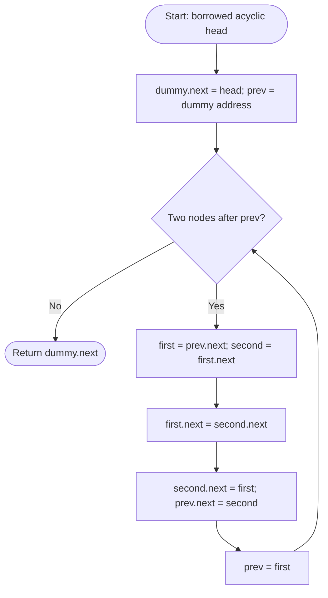
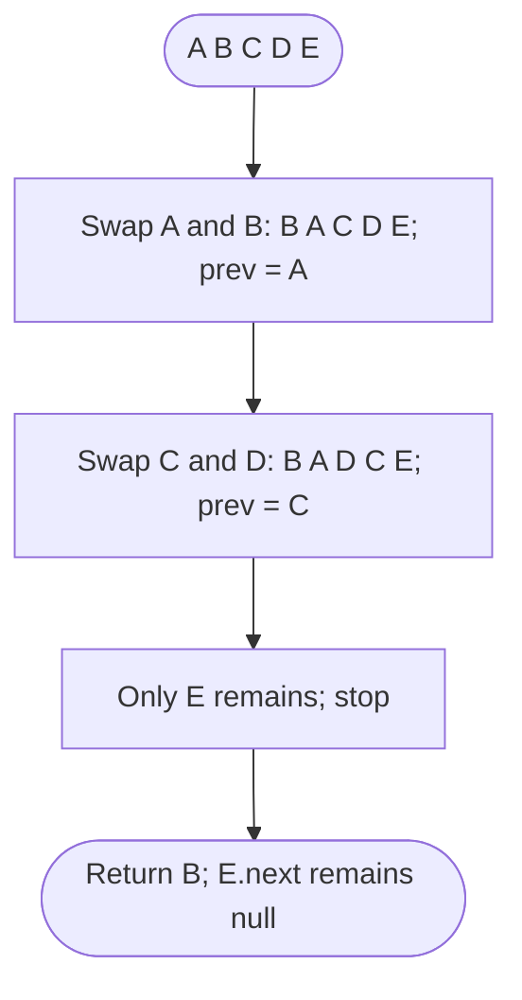
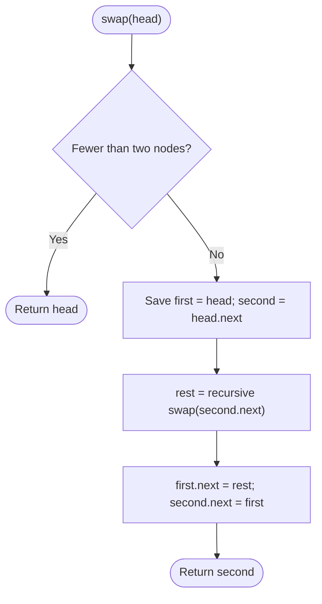
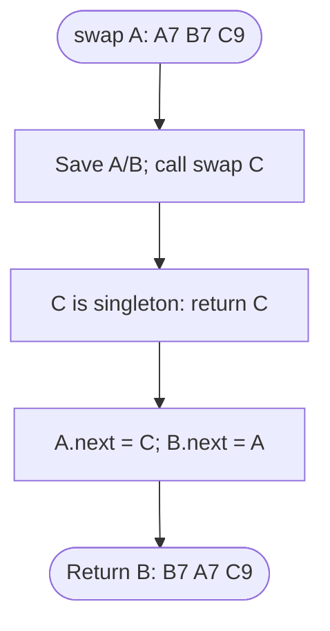

# Cornell Notes

## Topic: LeetCode - 24 - Swap Nodes in Pairs

## Date: 01/11/2026

Source: https://leetcode.com/problems/swap-nodes-in-pairs/

---

### Problem Description

Given the head of a singly linked list, swap every two adjacent **nodes** and return the resulting head. Do not modify node values. If the length is odd, leave the final node unchanged.

| Input | Output | Explanation |
|---|---|---|
| `[1,2,3,4]` | `[2,1,4,3]` | Exchange the first pair, then the second pair |
| `[]` | `[]` | No nodes |
| `[1]` | `[1]` | No complete pair |
| `[1,2,3]` | `[2,1,3]` | Retain the odd tail |

#### Constraints and Function Contract

- Number of nodes: `0..100`; each value: `0..100`.
- C: `struct ListNode *swapPairs(struct ListNode *head)`.
- C++: public `ListNode *Solution::swapPairs(ListNode *head)`.
- Input: null or a borrowed valid acyclic list. All reachable nodes remain alive throughout the call. Dangling pointers and cycles are outside the contract, not detected by this routine.
- Output: the same node identities, ordered by original zero-based indices `[1,0,3,2,...]`, with an unmatched final index retained. The last node points to null.
- Mutation: only `next` links change; values remain attached to their original nodes.
- Ownership: no allocation, freeing, copying nodes, or ownership transfer. The caller retains all nodes and must use the returned head.
- Local sources define `ListNode`. Omit that definition for LeetCode, which supplies it; submit the C function or C++ `Solution` class. `LOCAL_TEST` enables the standalone assertion main.

---

### Cue Column (Questions, Keywords, or Prompts)

| Cue | Recall target |
|---|---|
| Values or identities? | Exchange actual nodes; duplicate values still represent distinct nodes |
| Why a dummy? | Give the first pair the same predecessor treatment as later pairs |
| Why save two pointers? | Retain access to both nodes during rewiring |
| Why this write order? | Preserve the suffix before reversing the pair |
| Where does `prev` move? | To `first`, now the completed pair's tail |
| What invariant holds? | Correct paired prefix plus untouched attached suffix |
| What happens to an odd tail? | Guard fails; existing link retains it |
| Recursion cost? | Linear call stack instead of constant auxiliary space |
| Contiguous versus linked? | Value exchange is not node-identity permutation |

---

### Notes Section (Main Notes)

## Mindset First: Links, Not Values

An array allows constant-time access to adjacent indexed slots. Swapping their values changes slot contents, not the identities of the storage locations. A linked list may occupy unrelated addresses: follow `next`, not address arithmetic. This problem requires identity rewiring, even if two nodes contain the same number.

For nodes `A(7), B(7), C(9)`, the required output identities are `B, A, C`, although the displayed values remain `[7,7,9]`. A value-only test cannot distinguish the wrong solution. Test arrays are just convenient node storage; neither implementation assumes contiguous allocation.

This is the fixed `k = 2` case of neighboring problem 25 (Reverse Nodes in k-Group); a dedicated pair loop avoids unnecessary general reversal machinery.

## Strategy A: Iterative Dummy and Predecessor (Implemented)

1. Put `head` after a stack dummy; set `prev = &dummy`.
2. While two nodes follow `prev`, save `first = prev->next`, `second = first->next`.
3. Set `first->next = second->next` to preserve the suffix.
4. Set `second->next = first`, then `prev->next = second`.
5. Advance `prev = first`. Return `dummy.next` when fewer than two nodes remain.

```text
Before: prev -> first -> second -> rest
After:  prev -> second -> first -> rest
                            ^ new prev
```

The dummy has automatic storage, but only its `next` is returned. Its own address must never escape.

### Strategy A Flow



### Worked Example A: Odd-Length Iteration

Input identities: `A(1), B(2), C(3), D(4), E(5)`.

| State | `prev` | List from dummy | Untouched suffix |
|---|---|---|---|
| Initial | dummy | `A B C D E` | `A B C D E` |
| Pair 1 complete | A | `B A C D E` | `C D E` |
| Pair 2 complete | C | `B A D C E` | `E` |
| Guard fails | C | `B A D C E` | `E` unchanged |

First iteration writes `A.next = C`, `B.next = A`, `dummy.next = B`. Second writes `C.next = E`, `D.next = C`, `A.next = D`. Final output values: `[2,1,4,3,5]`.

### Strategy A Worked Example Flow



## Invariant and Correctness

At each loop boundary, the prefix after the dummy through `prev` is exactly the correctly swapped portion of the original list. `prev` is its tail (or the dummy for an empty prefix). `prev->next` starts the still-original-order suffix; every original node belongs to one portion, with unchanged value.

- **Initialization:** the prefix is empty and the complete original list is the suffix.
- **Preservation:** the guard proves both `first` and `second` exist. Saving their addresses and linking `first` to the suffix preserves reachability. Linking `second` to `first`, then the predecessor to `second`, exchanges exactly these two identities. Setting `prev = first` extends the correct prefix by two; later suffix links are untouched. Intermediate writes need not preserve a traversable whole list for concurrent readers; concurrent access is not supported.
- **Termination:** each iteration consumes two suffix nodes, so at most `floor(n/2)` iterations occur. A remaining zero or one node already has the required position. Returning `dummy.next` gives the complete desired list.
- **Complexity:** `O(n)` time, `O(1)` auxiliary space. The sentinel and pointer variables have constant size; no heap operations occur.

## Strategy B: Recursive Pair Decomposition (Conceptual)

Base case: return `head` if null or if `head->next` is null. Otherwise save `first = head`, `second = head->next`, recursively swap the suffix beginning at `second->next`, attach its result to `first->next`, set `second->next = first`, return `second`.

```text
swap(head):
    if head is null or head.next is null: return head
    first = head
    second = head.next
    first.next = swap(second.next)
    second.next = first
    return second
```

By induction on length: base lists need no swap; the recursive call correctly orders a shorter disjoint suffix, then the two saved nodes form the correct leading pair. `O(n)` time, `O(n)` auxiliary call stack (about `n/2` non-base calls). Shorter conceptual code, but not constant-space and can exhaust a bounded embedded stack. Paired sources implement iteration only.

### Strategy B Flow



### Worked Example B: Recursive Unwinding with Equal Values

Input identities `A(7), B(7), C(9)`:

| Call / return | Action | Result identities |
|---|---|---|
| `swap(A)` | Save A/B; call `swap(C)` | Pending pair A/B |
| `swap(C)` | Singleton base case | C |
| Resume `swap(A)` | `A.next = C; B.next = A` | B A C |

Output values `[7,7,9]` hide the exchange; returned head must be B, not A.

### Strategy B Worked Example Flow



## Common Failure Points

- Swapping `val` fields: violates identity and unchanged-value contracts.
- Returning the original head: first pair's new head is its second node.
- Reversing before saving the suffix: can lose nodes or introduce a cycle.
- Forgetting `prev->next = second`: disconnects the completed pair.
- Advancing `prev` to `second`: it is the pair's head, not its tail.
- Using only a one-node loop guard: dereferences a missing second node.
- Dropping the unmatched tail: keep `first->next = second->next`.
- Returning `&dummy`, freeing borrowed nodes, or allocating replacement nodes.
- Applying the routine twice in a test without rebuilding input: the second call restores the original order.

## Edge Cases to Test

| Case | Required identities / behavior |
|---|---|
| Empty | null result |
| Singleton A | A, still null-terminated |
| Pair A B | B A |
| Odd A B C | B A C |
| Even A B C D | B A D C |
| All equal values | Same identity permutation despite identical printed output |
| Alternating 0/100 | Preserve boundary values on their original identities |
| Maximum 100 nodes | Swap all 50 pairs; terminate at original index 98 |

Local assertions reconstruct lengths `0..100` with alternating boundary values, compare the exact returned head and every expected link, then check each original value. Independent verification additionally requires all-equal and ascending-mod-101 values across those lengths: 303 cases per language. Its index-order oracle must check every original node, not traverse potentially cyclic output. These are test specifications, not execution claims.

## Local Assertion Checks

From this exercise directory, using a POSIX-like shell with GCC tools on PATH. Build into a disposable OS temporary directory, never this curriculum folder:

```sh
build_dir=$(mktemp -d)
gcc -std=c11 -Wall -Wextra -Werror -pedantic -UNDEBUG -DLOCAL_TEST 24_swap_nodes_in_pairs.c -o "$build_dir/pairs_c" && "$build_dir/pairs_c"
g++ -std=c++17 -Wall -Wextra -Werror -pedantic -UNDEBUG -DLOCAL_TEST 24_swap_nodes_in_pairs.cpp -o "$build_dir/pairs_cpp" && "$build_dir/pairs_cpp"
rm -f "$build_dir/pairs_c" "$build_dir/pairs_cpp"
rmdir "$build_dir"
```

On Windows use an OS temporary directory and `.exe` output names. These guarded assertions exercise the production APIs; they do not replace independent review or the independent oracle. No build/test execution is claimed in these notes.

---

### Summary Section (Summary of Notes)

Swap identities, never values. A stack dummy normalizes the first pair; the predecessor tracks the completed prefix. Save both nodes, preserve the suffix, reverse the pair, reconnect, advance to the new pair tail. Fewer than two nodes means stop, retaining any odd tail. Iteration is `O(n)` time and `O(1)` auxiliary space without ownership changes. Recursion expresses the same decomposition but consumes `O(n)` stack space.
