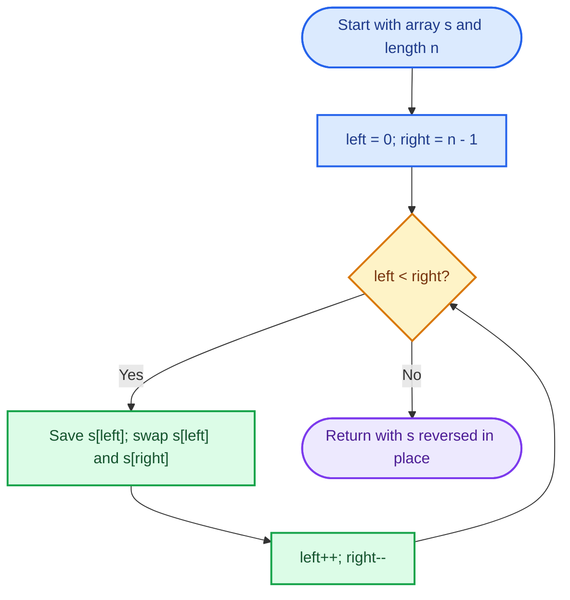
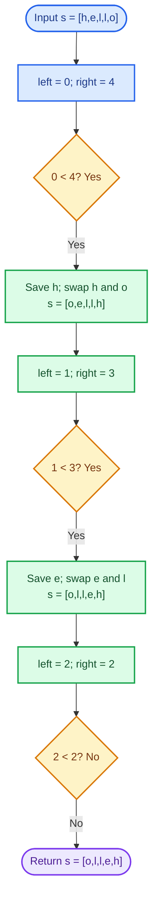
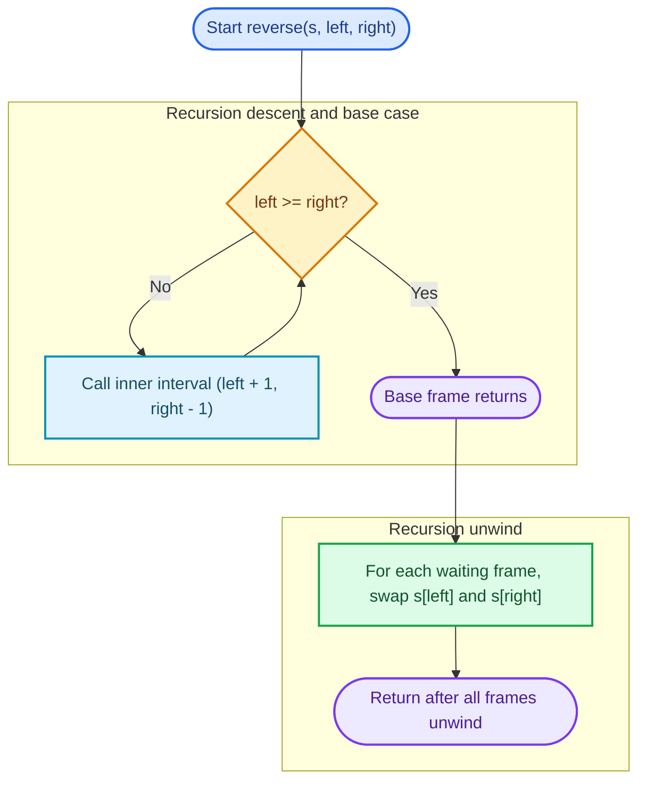
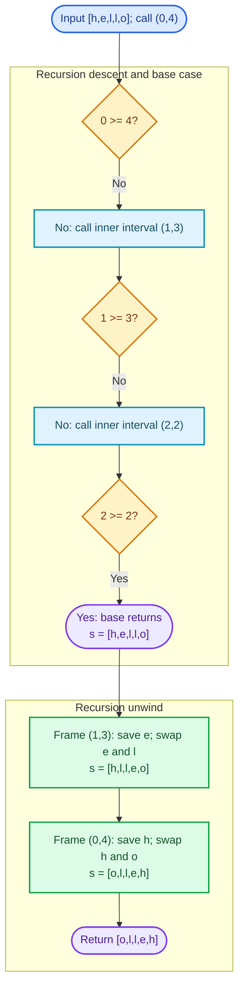

# Cornell Notes

## Topic: Leetcode - 344 - Reverse String

## Date: 11/10/2026

---

<p align="center"><strong><em>"DO NOT JUST TALK ABOUT IT — SHOW IT"</em></strong></p>

---

### Problem Description

Given a character array `s`, reverse its elements in place. The caller supplies a writable array; change the order of its existing characters without creating a replacement result.

Source: [LeetCode 344 - Reverse String](https://leetcode.com/problems/reverse-string/description/).

#### Example 1

```text
Input:  s = ["h","e","l","l","o"]
Output: ["o","l","l","e","h"]
```

#### Example 2

```text
Input:  s = ["H","a","n","n","a","h"]
Output: ["h","a","n","n","a","H"]
```

The same character values remain in the array, with their positions reversed.

#### Constraints

- `1 <= s.length <= 100000`.
- `s[i]` is a printable ASCII character.

#### Function Contract

- **Input:** C receives writable `char *s` and its explicit length `sSize`; C++ receives a mutable `std::vector<char>& s`.
- **Output:** Both functions return `void`; the caller inspects the modified input.
- **Mutation:** Reverse the characters in the caller-owned storage in place.
- **Ordering:** For original input `before`, every valid output position satisfies `s[i] == before[n - 1 - i]`.
- **Ownership or memory:** Keep the same array/vector and its length; the algorithm allocates no replacement character storage. C reads only indices `[0, sSize)`, with no trailing-NUL requirement.
- **Character model:** This reverses printable ASCII array elements. It does not define UTF-8 byte-sequence or Unicode grapheme reversal, and it is not a NUL-terminated-string operation.

---

### Cue Column (Questions, Keywords, or Prompts)

- Which pattern swaps opposite ends of a fixed array?
- What does the untouched prefix/suffix invariant say about positions already outside the active interval?
- Why do both indexes move inward after one swap?
- Why is `left < right` the correct loop condition?
- How can recursion express the same swaps, and what does its call stack cost?
- Which boundary, storage, and character-model assumptions can break an implementation?

---

### Notes Section (Main Notes)

## Mindset First (language-agnostic)

- Pattern: Two-pointer, in-place reversal of an indexed sequence.
- Invariant: Before each iteration, every position before `left` and after `right` already contains its final reversed value; only `[left, right]` remains active.
- Target time: `O(n)`.
- Target auxiliary space: `O(1)`.
- Optimality: Each character must participate in establishing the reversed arrangement; endpoint swaps complete the work in `floor(n/2)` operations without size-dependent storage.

An array provides direct indexed access, so the algorithm exchanges values at the two ends of one contiguous range. LeetCode 206 uses the same idea of reversing order but changes each linked-list node's `next` link; its nodes remain in place. Here the character values move between array positions.

## Strategy A: Iterative Inward Swaps

- Core idea: Keep inclusive endpoints of the unsolved interval, swap their characters, then shrink that interval.
- Algorithm:
	1. Set `left = 0` and `right = n - 1`.
	2. While `left < right`, save `s[left]`, exchange `s[left]` and `s[right]`, then increment `left` and decrement `right`.
	3. Stop when the indexes meet or cross; the array is reversed.
- Correctness: Initially the outside region is empty. A swap places the original right character at its required left-side reversed position and vice versa. Moving inward preserves those fixed positions and makes the active interval smaller. At termination at most one midpoint remains, and a midpoint maps to itself.
- Complexity: `O(n)` time and `O(1)` auxiliary space; at most `floor(n/2)` swaps and one saved character.
- Benefits: Meets the required constant-extra-memory bound, mutates existing storage, and has no recursion or allocation.
- Trade-offs: The C version depends on the caller's explicit valid length; an incorrect length can access outside the supplied object.

### Strategy A Flow



## Worked Example A: Inward Swaps on `[h,e,l,l,o]`

The left/right values are swapped until the active interval contains only its unchanged center character.

### Strategy A Worked Example Flow



## Strategy B: Recursive Inward Swaps (Educational Alternative)

- Core idea: Recurse on the smaller interval first; after reaching its center, swap the current interval's endpoints while calls unwind.
- Algorithm:
	1. For inclusive bounds `(left, right)`, return when `left >= right`.
	2. Recurse with `(left + 1, right - 1)`.
	3. On return, swap `s[left]` and `s[right]`.
- Correctness: The base interval has zero or one character and is already reversed. Assuming the inner interval is reversed, swapping its two outside characters places each at its required mirrored position. Each returning call therefore completes one larger interval.
- Complexity: `O(n)` time and `O(n)` auxiliary call-stack space (more precisely, `O(n)` asymptotically; the depth is about `n/2`).
- Benefits: Makes the nested-interval structure and unwind order visible for recursion practice.
- Trade-offs: It violates this problem's constant-extra-memory requirement and risks stack exhaustion on large inputs. Keep it as an explanation, not the submitted solution.

### Strategy B Flow



## Worked Example B: Recursive Swaps on `[h,e,l,l,o]`

Calls shrink from `(0,4)` to `(1,3)` to `(2,2)`; swaps then happen in reverse call order.

### Strategy B Worked Example Flow



## Outside-the-Interval Invariant and Termination

At the start of each iterative pass, the prefix `[0, left)` and suffix `(right, n)` already match their final reversed positions. The active interval `[left, right]` contains exactly the positions not yet fixed. One swap fixes up to two positions, then the interval loses two elements. Its width strictly decreases, so eventually `left >= right`. If one center element remains, its mirror is itself. Thus every index ends with the character originally at `n - 1 - i`.

## Common Failure Points (all languages)

- Use an exclusive end incorrectly or fail to stop at `left < right`, causing missed or duplicated swaps.
- Decrement an unsigned C++ right index when the vector is empty. The official domain requires at least one character; optional empty-input defense is a separate extension, not an official constraint.
- Read past the C array by guessing its length, calling `strlen`, or assuming a trailing NUL. The function receives the exact valid length.
- Resize or replace the C++ vector when only indexed assignments are required.
- Claim recursive auxiliary space is `O(1)`; the call stack grows with the input.
- Describe this as Unicode text reversal. The contract is printable ASCII character-array elements, not UTF-8 byte sequences or grapheme clusters.

## Edge Cases to Test

| Case | Input | Expected | Notes |
|------|-------|----------|-------|
| Minimum length | `[x]` | `[x]` | No swap; midpoint is fixed. |
| Unequal pair | `[a,Z]` | `[Z,a]` | Smallest changing input. |
| Distinct odd length | `[a,b,c,d,e]` | `[e,d,c,b,a]` | Center stays in place. |
| Distinct even length | `[a,b,c,d]` | `[d,c,b,a]` | No center element. |
| Repeated characters | `[x,x,x,x]` | `[x,x,x,x]` | Equal values still obey the contract. |
| Palindrome | `[l,e,v,e,l]` | Same sequence | Output can look unchanged. |
| Printable boundaries | `[space,~]` | `[~,space]` | Both are printable ASCII endpoints. |
| All printable ASCII | 95 characters | Reverse order | Covers the entire allowed character set. |
| Maximum length | `n = 100000` | Original order reversed | Check a non-palindrome and storage preservation. |
| Empty/null C input | Outside domain | No official expected result | Any defensive behavior is an optional extension. |

## Why Iterative Inward Swaps are Interview Gold

1. They achieve the required `O(n)` time with constant auxiliary space.
2. The interval invariant gives a short, complete correctness proof.
3. The solution uses direct indexing and exactly the required in-place mutation.
4. The same swap pattern applies to arrays and strings represented as mutable character storage, while making representation assumptions explicit.

## Implementation Checklist

- [ ] Start at inclusive indexes `0` and `n - 1`.
- [ ] Continue only while `left < right`.
- [ ] Save one endpoint character before overwriting it.
- [ ] Move both indexes inward exactly once per swap.
- [ ] Keep the C length explicit; do not call `strlen` or require NUL termination.
- [ ] Do not allocate, resize, or replace solution input storage.
- [ ] Test singleton, unequal pair, odd/even, repeated, palindrome, space/tilde, all ASCII, and maximum length.
- [ ] Treat empty input as outside the official constraints; if defending it, label that behavior optional.
- [ ] Count recursion stack as `O(n)` auxiliary memory; use iteration for the required implementation.
- [ ] Do not claim Unicode grapheme reversal.

### Reproducible PowerShell LOCAL_TEST Commands

Run from the repository root with GCC/G++ available at the paths used by the saved VeryThinker check. These commands keep generated executables in the system temporary directory.

```powershell
$buildDir = Join-Path $env:TEMP 'leetcode344-local-test'
New-Item -ItemType Directory -Force -Path $buildDir | Out-Null
$exercise = '02_Software/02_Programming-Fundamentals/01_Algorithms-and-Data-Structures/02_practice/03_data_structures/02_contiguous_vs_linked_structures/344_reverse_string'
& 'C:/msys64/mingw64/bin/gcc.exe' -std=c11 -Wall -Wextra -Werror -pedantic -DLOCAL_TEST "$exercise/344_reverse_string.c" -o (Join-Path $buildDir '344_c_test.exe')
if ($LASTEXITCODE -ne 0) { throw 'C compile failed' }
& (Join-Path $buildDir '344_c_test.exe')
if ($LASTEXITCODE -ne 0) { throw 'C LOCAL_TEST failed' }
& 'C:/msys64/mingw64/bin/g++.exe' -std=c++17 -Wall -Wextra -Werror -pedantic -DLOCAL_TEST "$exercise/344_reverse_string.cpp" -o (Join-Path $buildDir '344_cpp_test.exe')
if ($LASTEXITCODE -ne 0) { throw 'C++ compile failed' }
& (Join-Path $buildDir '344_cpp_test.exe')
if ($LASTEXITCODE -ne 0) { throw 'C++ LOCAL_TEST failed' }
```

---

### Summary Section (Summary of Notes)

Reverse String is an in-place two-pointer array problem. Maintain the invariant that everything outside `[left, right]` is already in its final reversed position; swap the endpoints and move inward until they meet. The iterative solution uses `O(n)` time and `O(1)` auxiliary space while preserving caller-owned storage. Its recursive counterpart teaches unwind order but costs `O(n)` stack space. The contract covers printable ASCII elements with an explicit array length, not NUL-terminated strings or Unicode graphemes.
