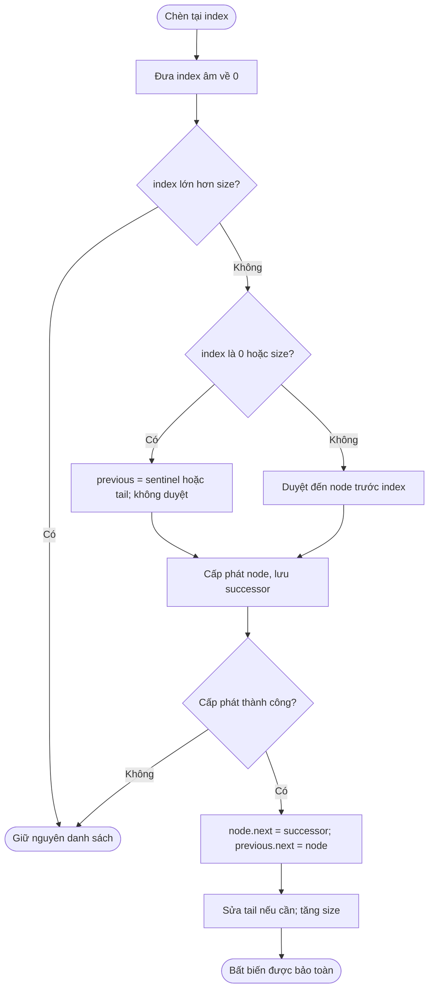
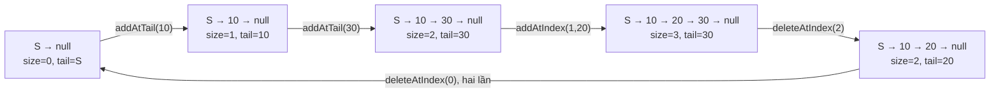

# Cornell Notes

## Topic: LeetCode 707 — Design Linked List

## Date: 24/10/2026

---

<p align="center"><strong><em>"DO NOT JUST TALK ABOUT IT — SHOW IT"</em></strong></p>

### Problem Description

Thiết kế một danh sách liên kết đơn có thể đọc, chèn và xóa theo chỉ số.
Khác bài 206 (đảo liên kết có sẵn), bài này yêu cầu tự quản lý toàn bộ vòng đời
của cấu trúc: khởi tạo → cấp phát → thay đổi liên kết → giải phóng.

Trước hết, hình dung trạng thái thực của một danh sách chứa `[10, 20, 30]`:

```text
                index 0       index 1       index 2
sentinel ─next─► [10 | next] ─► [20 | next] ─► [30 | null]
                                                ▲
                                               tail
size = 3; sentinel không phải phần tử dữ liệu.
```

#### Example 1

```text
MyLinkedList()       → []
addAtHead(1)        → [1]
addAtTail(3)        → [1, 3]
addAtIndex(1, 2)    → [1, 2, 3]
get(1)             → 2
deleteAtIndex(1)    → [1, 3]
get(1)             → 3
```

#### Example 2: chỉ số biên

```text
[] → addAtIndex(-5, 7) → [7] → deleteAtIndex(1) → [7]
get(-1) = -1; get(1) = -1; addAtIndex(2, 9) không thay đổi danh sách.
```

#### Function Contract

| API | Kết quả hoặc thay đổi |
|---|---|
| Khởi tạo / `myLinkedListCreate` | Rỗng: `size=0`, `sentinel.next=null`, `tail=&sentinel` |
| `get(index)` | Giá trị tại `0 <= index < size`; ngoài khoảng trả `-1` |
| `addAtHead(value)` | Chèn trước phần tử đầu |
| `addAtTail(value)` | Chèn sau phần tử cuối |
| `addAtIndex(index,value)` | Chỉ số âm được đưa về 0; `index==size` nối đuôi; `index>size` không làm gì |
| `deleteAtIndex(index)` | Xóa khi `0 <= index < size`; ngoài khoảng không làm gì |
| Hủy / `myLinkedListFree` | Giải phóng từng node thật, sau đó đối tượng C; không giải phóng riêng sentinel |

Chỉ số dùng `int`, giá trị cho phép toàn bộ miền `int`, kể cả `INT_MIN`, `-1`
và `INT_MAX`. Vì `-1` có thể là dữ liệu hợp lệ, riêng giá trị trả về `-1`
không đủ chứng minh chỉ số có hợp lệ hay không. Phải biết kích thước/tiền điều kiện.

**Phạm vi nguồn:** đây là hợp đồng phòng vệ đã duyệt trong bài tập local;
quy tắc chỉ số âm không được trình bày như trích dẫn đề mới nhất. **Upstream not
searched**: không truy cập mạng, không xác nhận giới hạn hay kết quả nộp trên
LeetCode. Nguồn của bài là yêu cầu đã lưu, thiết kế đã duyệt và các ví dụ local
ở cuối ghi chú.

### Cue Column (Questions, Keywords, or Prompts)

- Sentinel giải quyết tình huống “không có node trước head” bằng cách nào?
- `size` khác số lần gọi `add` như thế nào khi chèn có thể thất bại?
- Vì sao `tail` phải trỏ vào sentinel khi danh sách rỗng?
- Chèn đuôi O(1) có làm xóa đuôi thành O(1) không?
- Vì sao phải kiểm tra dấu trước khi đổi `int` sang `size_t`?
- Nếu `malloc` thất bại giữa chèn, dữ liệu cũ phải còn gì?
- Vì sao lớp C++ này cấm cả copy lẫn move mặc định?
- Kiểm thử giá trị đầu/cuối có bỏ sót một chu trình hoặc sai node ở giữa không?

### Notes Section (Main Notes)

## Mindset First (language-agnostic)

Đây là bài **duy trì bất biến qua nhiều thao tác**, không chỉ tính một đầu ra.
Sau mỗi thao tác, cấu trúc phải thỏa đồng thời:

1. `size` bằng số node dữ liệu có thể đi tới từ `sentinel.next`.
2. Sentinel được nhúng trong đối tượng, không nằm trong dữ liệu hay `size`.
3. Chuỗi kết thúc ở null, không có chu trình.
4. Rỗng: `tail=&sentinel`. Không rỗng: `tail` là node thật cuối cùng và `tail.next=null`.

Nếu một thao tác không hợp lệ hoặc cấp phát C thất bại, toàn bộ các bất biến và
dãy giá trị phải giữ nguyên. Đó là một phần của kết quả đúng, không phải chi tiết phụ.

## Strategy A: Sentinel + Size + Tail

**Chèn:** tìm node trước vị trí cần chèn; tạo node mới với `next` đã trỏ đúng
phần đuôi cũ; chỉ khi cấp phát thành công mới nối `previous.next` sang node mới.
Nếu `previous==tail`, cập nhật `tail`; sau đó tăng `size`.

**Xóa:** tìm `previous`; giữ `removed=previous.next`; nối vượt qua node bị xóa.
Nếu `removed==tail`, đổi `tail=previous`. Giảm `size`, rồi giải phóng `removed`.
Xóa node duy nhất tự đưa `tail` về sentinel vì lúc đó `previous` chính là sentinel.

**Đọc:** kiểm tra chỉ số rồi đi từ head đủ `index` bước. Sentinel không làm đọc
ngẫu nhiên thành O(1): vẫn phải đi qua liên kết.

### Strategy A Flow (generic)



Nhánh cấp phát thất bại của C trả về mà không thay đổi đối tượng. Trong C++, `new`
phát `std::bad_alloc` trước khi sửa liên kết. Hai ngôn ngữ có cách báo lỗi khác
nhau, cùng giữ trạng thái cũ. C không tăng `size` khi không tạo được node.

### Worked Example Flow (concrete)



### Operation-state trace

| Thao tác | `previous` | Liên kết thay đổi | Dãy sau thao tác | `size` | `tail` |
|---|---|---|---|---:|---|
| Khởi tạo | — | `S.next=null` | `[]` | 0 | S |
| `addAtTail(10)` | S | `S.next=A` | `[10]` | 1 | A=10 |
| `addAtTail(30)` | A | `A.next=C` | `[10,30]` | 2 | C=30 |
| `addAtIndex(1,20)` | A | `B.next=C`, rồi `A.next=B` | `[10,20,30]` | 3 | C=30 |
| `deleteAtIndex(2)` | B | `B.next=null`, giải phóng C | `[10,20]` | 2 | B=20 |
| `deleteAtIndex(0)` | S | `S.next=B`, giải phóng A | `[20]` | 1 | B=20 |
| `deleteAtIndex(0)` | S | `S.next=null`, giải phóng B | `[]` | 0 | S |

Tên A/B/C là danh tính node để phân biệt với giá trị; hai node có thể cùng mang
giá trị `7` nhưng vẫn là hai vùng nhớ khác nhau.

### Correctness sketch

Ban đầu bất biến đúng với chuỗi rỗng. Chèn nối thêm đúng một node giữa hai điểm
đã biết, giữ nguyên thứ tự phần còn lại; chỉ sửa tail khi nối sau node cuối.
Xóa nối qua đúng một node và đổi tail về tiền nhiệm khi cần. Cả hai thay đổi
`size` đúng một đơn vị. Trường hợp không hợp lệ không sửa trạng thái. Suy nạp
theo số thao tác, mọi trạng thái thành công đều tiếp tục thỏa hợp đồng.

### Complexity

| Thao tác | Thời gian tệ nhất | Bộ nhớ phụ cho thao tác |
|---|---:|---:|
| Khởi tạo | O(1) | O(1) |
| `addAtHead`, `addAtTail` | O(1) | O(1), thêm một node |
| `addAtIndex` ở 0 hoặc `size` | O(1) | O(1), thêm một node |
| `get`, chèn giữa, `deleteAtIndex` | O(n) | O(1) |
| Hủy danh sách | O(n) | O(1), duyệt lặp |

Toàn bộ node sở hữu chiếm O(n). Tail giúp **nối đuôi**, nhưng danh sách đơn không
có con trỏ lùi để tìm tiền nhiệm của tail khi xóa đuôi; vì vậy xóa đuôi vẫn O(n).
Mảng/vector trong harness chỉ là mô hình tham chiếu, không phải cấu trúc cài đặt.

### Ownership and common failure points

- **Mất tail sau xóa cuối:** lần append tiếp theo ghi vào vùng nhớ đã giải phóng.
- **Đếm sentinel:** làm sai `size`, cho phép truy cập một vị trí không tồn tại.
- **Đổi số âm sang `size_t` trước:** số âm biến thành số dương rất lớn; xử lý dấu trước.
- **Nối trước khi cấp phát xong:** dễ làm sai trạng thái khi `malloc` trả null.
- **Sao chép mặc định C++:** nhân đôi con trỏ sở hữu gây double-delete; kể cả đối
  tượng rỗng cũng có tail trỏ về sentinel của chính nó. Bản này xóa cả bốn phép
  copy/move, chưa cài deep copy hay chuyển quyền sở hữu.
- **Hủy đệ quy:** tốn stack theo n; bản này lưu successor rồi giải phóng lặp.
- **Tràn bộ đếm:** C từ chối thêm khi `size==SIZE_MAX`; C++ phát `length_error`.
  Đây là chốt bảo vệ mã nguồn, không phải một giới hạn bộ nhớ đã thực nghiệm.

### Edge-case table

| Đầu vào/tình huống | Kết quả phải có |
|---|---|
| Rỗng: đọc/xóa 0 | `-1` / không thay đổi |
| Một node: xóa 0 rồi append | Tail trở về S, append tạo chuỗi mới hợp lệ |
| Chèn chỉ số âm, kể cả `INT_MIN` | Chèn head |
| Đọc/xóa chỉ số âm | Không truy cập node |
| Chèn ở `size`; đọc/xóa ở `size` | Nối đuôi; đọc `-1` / xóa không làm gì |
| Chỉ số lớn hơn `size`, `INT_MAX` | Không thay đổi / đọc `-1` |
| Giá trị trùng, `INT_MIN`, `-1`, `INT_MAX` | Giữ nguyên giá trị và thứ tự |
| Hai đối tượng | Sửa một đối tượng không thay đổi đối tượng kia |
| C: cấp phát thất bại | Giá trị, size, tail giữ nguyên; create có thể trả null |
| C: truyền đối tượng null | Đọc `-1`, mutation/free không làm gì |

### Implementation checklist

- [x] API C/C++ theo tên yêu cầu, sentinel + size + tail.
- [x] Kiểm tra dấu trước khi chuyển sang kích thước không dấu.
- [x] Nhánh head/tail không duyệt danh sách.
- [x] Cấp phát trước khi nối; xóa/hủy giải phóng đúng node thật.
- [x] Xóa copy/move C++; harness C++ chỉ có khi `LOCAL_TEST`.
- [x] Kiểm tra toàn bộ dãy, size, tail và kết thúc null bằng duyệt có giới hạn.
- [x] 2000 thao tác xác định trong mỗi harness, seed `0x707c2026`.
- [x] Tình huống biên, lỗi cấp phát C và đếm cấp phát/giải phóng.

### Reproduce: PowerShell, C11 and C++17

Chạy từ `D:\workspace\NeoLearning`. Thư mục compiler cần có trong **PATH của
tiến trình hiện tại** để các tiến trình con `cc1/cc1plus` tìm thấy DLL; chỉ dùng
đường dẫn tuyệt đối đến gcc chưa đủ trên máy này. Không thay PATH hệ thống.
Binaries được đặt trong vùng `.neomind/runs` được bỏ qua bởi Git.

```powershell
$env:PATH = 'C:\msys64\mingw64\bin;' + $env:PATH
$src = '02_Software/02_Programming-Fundamentals/01_Algorithms-and-Data-Structures/02_practice/03_data_structures/02_contiguous_vs_linked_structures/707_design_linked_list'
$out = '.neomind/runs/707-local'
New-Item -ItemType Directory -Force -Path $out | Out-Null

& 'C:/msys64/mingw64/bin/gcc.exe' --version
& 'C:/msys64/mingw64/bin/g++.exe' --version
& 'C:/msys64/mingw64/bin/gcc.exe' -std=c11 -Wall -Wextra -Wpedantic -static "$src/707_design_linked_list.c" -o "$out/707-c.exe"
if ($LASTEXITCODE -ne 0) { throw 'C compile failed' }
& "$out/707-c.exe"
if ($LASTEXITCODE -ne 0) { throw 'C tests failed' }

& 'C:/msys64/mingw64/bin/gcc.exe' -std=c11 -Wall -Wextra -Wpedantic -DLOCAL_TEST -static "$src/707_design_linked_list.c" -o "$out/707-c-local.exe"
if ($LASTEXITCODE -ne 0) { throw 'C allocation-test compile failed' }
& "$out/707-c-local.exe"
if ($LASTEXITCODE -ne 0) { throw 'C allocation tests failed' }

& 'C:/msys64/mingw64/bin/g++.exe' -std=c++17 -Wall -Wextra -Wpedantic -DLOCAL_TEST -static "$src/707_design_linked_list.cpp" -o "$out/707-cpp.exe"
if ($LASTEXITCODE -ne 0) { throw 'C++ compile failed' }
& "$out/707-cpp.exe"
if ($LASTEXITCODE -ne 0) { throw 'C++ tests failed' }

# Submission interface: no main or test-only methods when LOCAL_TEST is absent.
& 'C:/msys64/mingw64/bin/g++.exe' -std=c++17 -Wall -Wextra -Wpedantic -c "$src/707_design_linked_list.cpp" -o "$out/707-submission.o"
if ($LASTEXITCODE -ne 0) { throw 'C++ submission compile failed' }
```

### Verification: expected versus observed

**Expected:** mọi case báo `PASS`, tổng passed bằng total và exit code 0; compiler
không có cảnh báo. Sai lệch phải báo `FAIL`, ghi expected và trả exit khác 0.

**Observed, implementer preflight 24/10/2026:** GCC/G++ 13.1.0 (MSYS2 Rev6),
Windows x86-64; cả bốn lệnh compile ở trên thành công, không có chẩn đoán.
C thường: **7/7**, 2038 kiểm tra trạng thái; C `LOCAL_TEST`: **9/9**, 2043 kiểm
tra trạng thái, 1226 cấp phát thành công / 1226 giải phóng; C++ `LOCAL_TEST`:
**7/7**, 2038 kiểm tra trạng thái, 1220 cấp phát / 1220 giải phóng. Cả ba chương
trình trả exit 0. Log preflight nằm ở
`.neomind/runs/707-implementer-preflight-20261024/`.

Đây là preflight của người triển khai. Check độc lập được quản lý bằng
`NM-11D03369-CHK-0001` (compile + oracle API riêng) và `NM-11D03369-CHK-0002`
(đọc mã/ghi chú); trạng thái và evidence mới nhất nằm trong workflow
`NM-11D03369-KNW-0036`. Không suy ra pass độc lập chỉ từ preflight.
Đếm cân bằng và fault injection bao phủ các lần chạy này, không thay thế
ASan/Valgrind hay chứng minh không có mọi lỗi bộ nhớ. Chưa chạy leak tool,
chưa nộp upstream, chưa thực nghiệm C++ `bad_alloc` hay `SIZE_MAX`.

### Practice Questions

1. Với `S → 4 → 9 → null`, `size=2`, `tail=9`, hãy mô tả chính xác ba trường
   thay đổi sau `deleteAtIndex(1)`. Lần `addAtTail(7)` tiếp theo nối ở đâu?
2. Vì sao lưu `tail` giúp append O(1), nhưng `deleteAtIndex(size-1)` vẫn O(n)?
   Muốn cải thiện xóa cuối cần thêm thông tin gì và phải trả giá gì?
3. C đang chứa `[10,30]`, gọi `addAtIndex(1,20)` nhưng cấp phát thất bại.
   Giá trị, `size`, `tail` và số cấp phát thành công phải thay đổi thế nào?
4. Tại sao test `get(0)` và `get(size-1)` đúng vẫn chưa đủ? Hãy cho một lỗi
   ở giữa danh sách hoặc ở liên kết cuối có thể bị bỏ sót.

### Answer Explanations

**1.** Tiền nhiệm là node 4. `4.next=null`, `tail=4`, `size=1`; node 9 được giải
phóng. Append nối node 7 vào `4.next`, rồi đổi `tail=7`, `size=2`. Nếu quên sửa
tail khi xóa, append sẽ dùng con trỏ tới node 9 đã được giải phóng.

**2.** Append đã biết node cuối, nhưng xóa cuối phải biết node đứng trước nó.
Danh sách đơn không có `prev`, nên phải đi từ sentinel. Danh sách đôi thêm
`prev` có thể xóa tail O(1), đổi lại thêm bộ nhớ và nhiều bất biến khi nối/xóa;
đọc một chỉ số bất kỳ vẫn cần duyệt.

**3.** Dãy vẫn `[10,30]`, `size=2`, `tail` vẫn là node 30. Không có cấp phát
thành công mới, không có liên kết nào thay đổi và không cần giải phóng một node
chưa tạo được. Fault hook trong bản C kiểm tra đúng trường hợp này.

**4.** Dãy `[1,2,3]` bị đổi nhầm thành `[1,99,3]` vẫn giữ hai đầu đúng; một
liên kết từ node cuối quay về node giữa cũng có thể chưa lộ trong hai lần đọc.
Harness so mọi giá trị với oracle, so size, đi tối đa đúng số node kỳ vọng rồi
yêu cầu con trỏ đã null và tail đúng node cuối; nhờ vậy chu trình/extra node
không làm test treo vô hạn.

### Local Sources

- [206 Cornell note](../206_reverse_linked_list/206_note.md): cách diễn giải
  bất biến, con trỏ tạm và Mermaid generic/concrete.
- [203 C++ implementation](../203_remove_linked_list_elements/203_remove_linked_list_elements.cpp):
  ví dụ quản lý node và harness có tổng pass/total.
- [83 Cornell note](../83_remove_duplicate_from_sorted_lists/83_note.md): cue,
  hợp đồng, phân tích độ phức tạp và edge cases.
- Yêu cầu `NM-11D03369-REQ-0007` rev3; thiết kế
  `NM-11D03369-DES-0002`; task `NM-11D03369-TASK-0001` trong `.neomind/records/`.

### Summary Section

Sentinel cho mọi vị trí một tiền nhiệm; size quyết định chỉ số hợp lệ; tail
tránh duyệt khi append. Mỗi chèn/xóa phải bảo toàn cả dãy giá trị lẫn bất biến
sở hữu, đặc biệt khi xóa node cuối hoặc cấp phát thất bại. Học bài này bằng cách
vẽ liên kết trước/sau một thao tác, tự dự đoán tail/size, rồi đối chiếu trace và
harness; không chỉ nhìn một lần `get` trả đúng.
