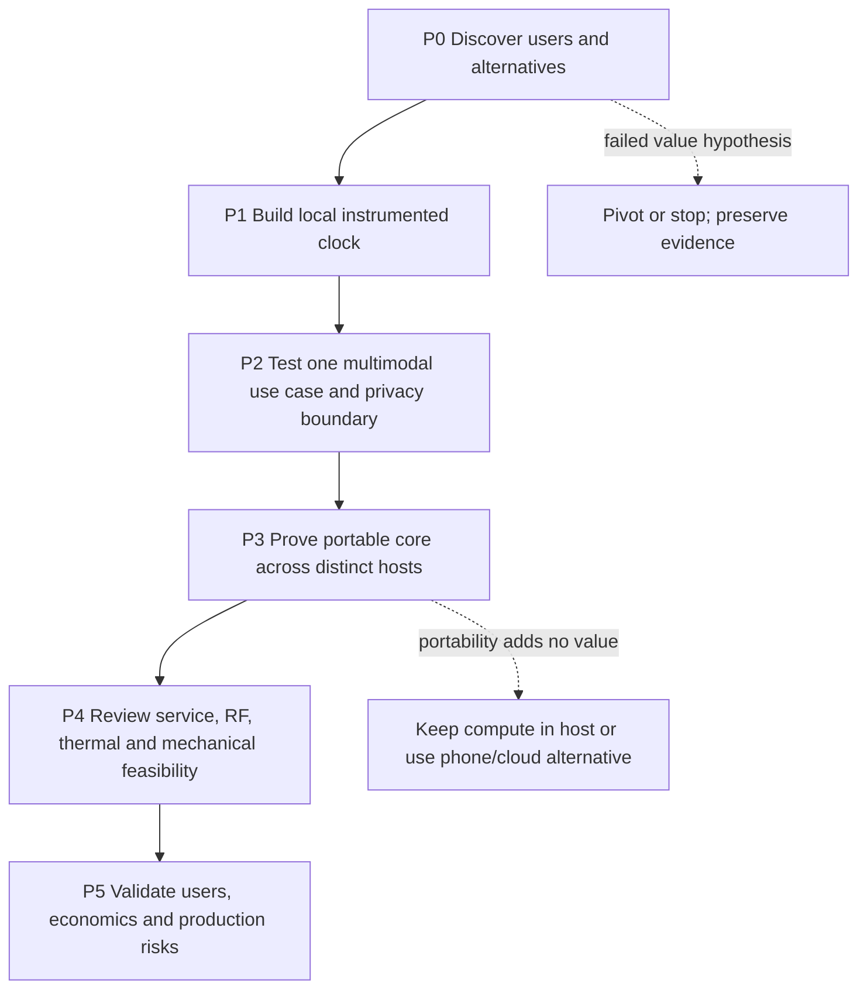
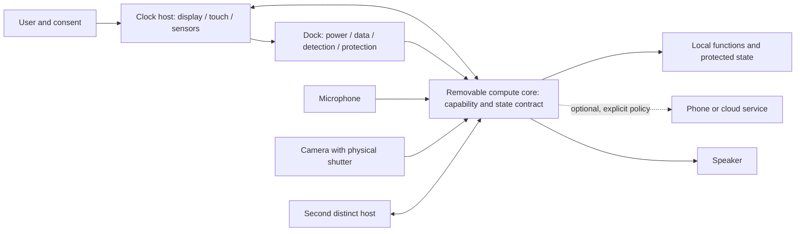

# Product-owner study roadmap: modular AI desk clock

**Purpose:** learn enough to make evidence-based product decisions, challenge specialist claims, and own customer, cost, safety, privacy, and release outcomes. This is a proposed learning plan—not a frozen design, approved specification, university timetable, or promise of a commercial product.

> **Start here:** validate the user problem before custom hardware. Prove portability before shrinking the core. Keep clock functions useful offline. Treat every numerical product target as **TBC** until the owner approves conditions and evidence.

## Cornell cues

- Which facts are observed, proposed, or still unknown?
- What is the cheapest experiment that could change the decision?
- Which owner decisions need specialist evidence?
- Does a calculation establish feasibility—or only a number under assumptions?

## At a glance

| Phase | Illustrative sequence | Hours | Main result / exit gate |
|---|---:|---:|---|
| P0 Problem framing | 8 weeks (12-month) / 12 (18-month) | 120 | User evidence, prioritized jobs, alternatives, initial FR/TBC and go/pivot/stop memo |
| P1 Instrumented clock | 8 / 12 weeks | 120 | Local clock prototype, reproducible setup, UI/sensor/power observations |
| P2 Multimodal boundary | 8 / 12 weeks | 120 | Measured audio/AI use case, consent/privacy controls, offline/error behavior |
| P3 Portability proof | 8 / 12 weeks | 120 | Same core demonstrated across two distinct hosts; interface and budget evidence |
| P4 Serviceable alpha | 8 / 12 weeks | 120 | Reviewed mechanical, RF, thermal, service and assembly evidence |
| P5 Validation/business | 8 / 12 weeks | 120 | User pilot, cost scenarios, risk disposition, conditional industrialization plan |

**Workload is illustrative:** 48 active weeks × 15 h/week = 720 h; or 72 × 10 h/week = 720 h. At 6 h/week, 720 h takes 120 active weeks. Exams, work, procurement and specialist lead times may extend elapsed time. The source syllabus/calendar is not reliably readable; these are not course dates or credits. Do not double-count course work. Pause or replan when a gate fails.

Weekly routine: theory/course linkage; one small experiment; product/customer/cost work; evidence and review. Record a question, assumption, source or measurement, failure, decision, and next test. Every four active weeks revisit time, spend, scope, and evidence.

## Learning path

## Five-course bridge—not a syllabus claim

| Observed course folder | Proposed product bridge | Owner artifact | Unknown / supplement |
|---|---|---|---|
| Optimal Design for Mechatronic Systems | CN/FR/DP, coupling, trade-offs, portability vs repair/energy | Revise FR×DP matrix and compare allocations | Actual teaching/outcomes unseen; add user validation, reliability and economics if needed |
| Industrial Electronics for Mechatronics System | Power states, regulators, protection, grounding, measurement | Read power tree; measure idle/peak current; safe-fault review | File names do not establish battery, RF, audio or safety coverage |
| Philosophy | Critical reasoning, assumptions, social effects and ownership | Evidence-vs-belief memo; privacy/accessibility dilemmas | Does not replace legal, UX or business expertise |
| Signal Processing for Mechatronic System | Sampling, filtering, speech/noise and latency | Compare baseline/filter, SNR, latency and false activations | Topics/outcomes unseen; codec, microphone geometry and evaluation methods may need supplements |
| Computer Architecture | Compute/memory/bandwidth, interrupts/DMA and partitioning | Draw data path; calculate RAM/bus budgets; profile workload | Exercise exists; exact CPU/cache/accelerator/OS coverage unknown |

Follow the actual university sequence only when verified. Product prerequisites: units/basic circuits before energy; embedded programming/Git/debugging before concurrency; sampling before audio filtering; requirements and interviews before custom interfaces; measured power, thermal, interface and portability evidence before miniaturization. FPGA is optional; consider only after a measured workload defeats simpler available options.

## Ownership: decide, build, review

| Product owner must understand and decide | Prototype directly | Delegate, then independently review |
|---|---|---|
| Customer/job, priorities, CN/FR/DP, target user/market, budget, acceptable risks, privacy promises, evidence quality, continue/pivot/stop | UI, paper/cardboard mock-up, simple sensor/audio logging, worksheets, host negotiation and test scripts using standard modules | Production RF/antenna and emissions; mains; lithium pack/protection/charging; detailed PCB/power integrity; acoustic tuning; tooling; penetration testing; legal/privacy advice; compliance and volume production |

Keep acceptance, budget, hazard disposition, and supplier accountability. Require delegated work to include interfaces, assumptions, editable source, BOM, test data/configuration, known defects, IP/licensing, sign-off, and maintenance ownership. Never outsource understanding of failure consequences.

## Product concept boundary

Concept intent supplied for this study: touch clock, camera shutter, speaker/microphones, IMU/light sensing, removable rear core (32×28×8 mm concept; four contacts), battery base. None is validated by this note. Start with a larger development module, known connector, external supply, and mock enclosure. No custom PCB, tiny core, FPGA, new modeling tool, or cloud dependency is prerequisite. Compare the value of portability with a phone/cloud account-sync alternative before paying its complexity cost.

This is a conceptual allocation, not an electrical design. Four contacts do not define protocol, bandwidth, grounding, power sequencing, protection, or safety. Shutter does not electrically disable microphones. Define trust boundaries and capability behavior before interface freeze.

## Phase gates and minimum learning evidence

Counts below are proposed experiment minima, not statistically validated market demand, reliability qualification, or certification. Record hardware/software revision, conditions, instrument limits, expected/actual result, defects, and decision. Numerical performance limits stay TBC until owner approval.

### P0 — Problem framing (120 h)

Study interviews, requirements, CN/FR/DP, trade-offs, ethics, units, basic circuits/programming. Inspect the actual axiomatic-design note; create glossary, assumptions/hazards, and one-page brief. Interview at least five plausible desk users without selling the concept. Compare plain clock, phone assistant, and modular concept; test paper UI and removable-core mock-up. Ask what should travel with the user, and why a second host is worth buying.

**Exit:** five anonymized interviews; three prioritized jobs; no-camera/no-cloud alternative; disposition for CN1–CN12; initial FR1–FR10 and TBC register; owner records budget, price band, target user/market or names these blockers. Go/pivot/stop memo states limitations. No PCB purchase gate.

### P1 — Instrumented local clock (120 h)

Study circuits, digital architecture, embedded C/C++, Git, basic buses, timers/interrupts, display/touch events, sensor calibration, state machines. Use an existing board/display, suitably protected external supply. Make clock useful without account/cloud; implement honest offline/error states, time source/drift/time-zone/DST/outage policy. Add simple IMU/light logs and dimming; learn debounce, filtering, sleep/wake.

**Exit:** reproducible setup and license/dependency inventory; ten scripted clock/touch scenarios including reboot/network/sensor failure; ten touch-latency trials; readability observations at recorded conditions; active/idle/sleep current and method. Explain architecture, data flow, power; update FR1/FR2.1/FR6/FR7. These observations do not pass unapproved TBC targets.

### P2 — One multimodal use case (120 h)

Study sampling/filtering, audio path, microphone/speaker placement, echo, image bandwidth, AI task evaluation, network failures, local/phone/cloud allocation. Add one voice command and intelligible response before broad features. Add camera only for a validated job, with shutter and clear capture state; gesture optional. Compare deterministic/local behavior to AI benefit. Define permission, retention, deletion, and threat model.

**Exit:** local/phone/cloud decision by function; at least 20 consented or synthetic evaluation inputs across two recorded acoustic conditions; observed activation/false activations, latency, CPU/RAM/energy; matrix testing shutter/mic disable and indicators; ten offline/timeout/rate-limit/error scenarios leave clock usable. Specify acceptable behavior before pass/fail. No always-on raw recording assumed.

### P3 — Portability and system feasibility (120 h)

Study interface contracts, capability discovery, power sequencing, protection, grounding, state consistency, authentication, safe removal. Start with larger standard module and known connector. Second host must be materially different (for example audio-only cradle), not duplicate housing. Decide what state belongs to core/host/cloud; protect credentials; define shutdown, interrupted transfer, and mismatch behavior. Have specialists review battery/dock experiments; do not improvise hazardous lithium fault tests.

**Exit:** same physical core moved A→B→A for ten logged round trips; agreed identity/state persists without reflashing or manual host identity copying; capabilities select supported features; absent/mismatched core, interrupted write, network loss and unpowered host have specified safe behavior. Compare phone/cloud sync. Record current/inrush/contact drop, sustained load/errors; cost/energy/bandwidth ranges and specialist-reviewed hazard plan. Failure means retain larger core/connector, move processing into host, simplify workload, or pivot—not force four contacts.

### P4 — Serviceable alpha (120 h)

Study load paths, tolerances, retention, acoustics, thermal paths, antenna keep-outs, EMC/ESD, assembly and service access. Build around proven modules; compare material/RF windows and stability. Custom PCB only when standard modules demonstrably block cost/size/power/reliability and review supports change. Evaluate the compact-core stack-up including component/connector travel, retention, shielding, antenna space, tolerances and heat flow.

**Exit:** costed assembly/disassembly; battery/module replacement timed across three attempts without damage; insertion-cycle target approved from intended service life; thermal logs at defined conditions; docked/undocked link comparison; reviewed safe tip/retention/misalignment checks; specialists disposition high risks. Achieve 32×28×8 mm with evidence or revise/defer. Metal/recycled material remains conditional on RF, isolation, sourcing, finish and recyclability. Prototype checks are not certification.

### P5 — Validation and business (120 h)

Study EVT/DVT/PVT, suppliers/yield/test fixtures, change control, conditional compliance, landed cost, support, privacy incident response, end-of-life. Supervised pilot with at least five intended users and preregistered tasks, consent and safe hardware. Track task success, setup time, nuisance activation, retention, portability use, defects and support. Buying intent alone is weak evidence.

**Exit:** FR/C/TBC coverage; five pilot records; critical safety/privacy defects fixed and rechecked or block unsupervised release; low/base/high volume and cloud scenarios; target-market compliance owner/lab consultation; supplier/production, update/support/cloud shutdown commitments; residual risk and go/pivot/stop memo. EVT learning may be feasible; DVT/PVT, certification and launch require separate time, funds, expertise and authorization.

## Three decision worksheets

Keep units, source/date, workload/ambient, low/base/high values, uncertainty, owner, revision and measured-vs-assumed flags. Unsupported point estimates never become commitments.

### Cost and cloud

Track BOM, quantity, supplier/date/currency, MOQ/lead time, second source, assembly/test, yield/rework, freight/duty/packaging, NRE, warranty/returns, channel/payment fees, support, cloud, revenue, spares and replacement hosts/core/battery. Scenarios are not forecasts.

- Landed hardware = BOM + assembly/test + scrap/rework + logistics/duties + packaging.
- Unit NRE allocation = NRE / conservative units.
- Lifetime variable cost = landed cost + warranty + support + expected cloud exposure.
- Contribution = net revenue after fees − lifetime variable costs; break-even = fixed investment / positive contribution.

Illustration only: 100 receipt − 45 hardware − 10 warranty/support − 12 expected cloud subsidy = **33 contribution units**, before NRE/tax/fixed overhead. 100 requests/day × 0.002 × 30 days = **6 cloud units/month**; 12 reserve covers two such months, not lifetime. Model zero/normal/heavy use, outage, price rise. Quotas or paid options must not break local clock. Subscription, hardware-only and bring-your-own-provider need user validation.

### Energy and thermal

Track rail, voltage, active/idle/sleep current, duty, duration, efficiency, usable capacity/aging/temperature, peak/inrush, charge concurrency, source and instrument. Exclusive mode duty fractions sum to 1; concurrent loads sum. Average power = Σ(V×I×duty) plus conversion/standby losses. Usable energy = nominal V × Ah × usable fraction. Runtime = usable Wh / average battery-input W. Avoid double-counting efficiency if measured at battery. Peak capability is separate. Record wake/parasitic/backfeed. Thermal log ambient, local dissipation, simultaneous workload, contact/enclosure temperature and sensor. First-order ΔT = watts × justified thermal resistance; dock heat transfer cannot be assumed.

Illustration only: 3.7 V × 2 Ah × 0.8 = **5.92 Wh**; at 0.8 W average, **7.4 h idealized**. Not a chosen battery or runtime promise. Measure battery-input average and peak over representative workload/environment; include aging, conversion and cutoff behavior.

### Bandwidth, memory and latency

Track producer/consumer, encoding, sample/frame rate, channels, bits, burst, duty, protocol overhead, sustainable goodput, buffer RAM, latency allocation, retries and power. Raw rate = rate × samples/pixels × bits. Sum simultaneous streams; include framing/contention/headroom. Buffer bytes = byte rate × worst blocked interval; average compression does not prove worst-case capacity.

Illustration only: 16 kHz mono 16-bit PCM = **256 kbit/s**. 320×240 RGB565 at 10 fps = **12.288 Mbit/s**; one frame = **153,600 bytes**; combined = **12.544 Mbit/s**, before overhead. This proves no link feasibility. Measure goodput/latency/errors and protocol overhead; consider lower camera rate/resolution, host processing, feature transmission, or another interface.

## FR1–FR10 and C1–C9 traceability

| ID | Requirement/constraint | Learning disposition |
|---|---|---|
| FR1 | Visual clock/readability/time policy | P0 intended use; P1 measured UI; P5 user validation |
| FR2 | Touch/voice/visual input | P1 touch; P2 latency/false activation; modes may defer |
| FR3 | Audio | P2 intelligibility/noise/latency; P4 enclosure acoustics |
| FR4 | Portable state | P3 two-host proof; P5 portability value |
| FR5 | Power/data dock | P3 contracts/load; P4 reviewed cycles/ESD/misalignment |
| FR6 | Energy | P1–P4 state, energy, charging and thermal worksheets/tests |
| FR7 | IMU/light | P1 calibration, sampling and wake behavior |
| FR8 | Structure | P4 stability/load/thermal/RF; battery base is a hypothesis |
| FR9 | Privacy | P0 consent; P2 disable/indicator; P3 trust boundary; P5 validation |
| FR10 | Service | P3 safe removal; P4 service/cycles; P5 spares/support |
| C1 | Size | P3 alternatives; P4 stack-up; revise if evidence requires |
| C2 | Four contacts | P3 electrical/data feasibility; may reject |
| C3 | Materials | P4 RF/safety/sourcing assessment |
| C4 | Safety | P0 hazards; specialist review before energized battery/dock tests; market review P5+ |
| C5 | Independent structural support | P4 load-path inspection |
| C6 | Module power states | P1–P4 energy/state contracts |
| C7 | Separable materials/low adhesive | P4 service evidence |
| C8 | Balanced geometry | P4 stability/ergonomics |
| C9 | Affordable/available parts | P0/P3/P5 cost alternatives and lead time |

Eight inherited decisions remain open until owner-approved thresholds/evidence: (1) viewing distance/light—owner P0→P1; (2) local/phone/cloud—owner plus architecture/security P2; (3) transfer continuity—owner P0, prove P3; (4) peak/average/runtime/charge—owner plus power expert P1–P3; (5) camera workload—owner plus DSP/architecture P2; (6) noise/audio/privacy—owner plus acoustic/security P2; (7) four-contact architecture—architect/electrical expert P3; (8) cycles/drop/service/cost—owner plus mechanical/manufacturing P3–P4. Log threshold, conditions, rationale, owner, gate and evidence. Unresolved threshold blocks that claim, not learning.

Dock review: reference/sequence, current/contact resistance/wear, polarity/keying, bounce/inrush/precharge, backfeed, exposed-contact ESD, return path/signal integrity, attach detection, hot-plug, retention/tolerance, corrosion/cleaning, authentication, capability/version negotiation, updates and absent-core behavior. RF review: antenna/keep-out, metal/battery/hand/dock detuning, coexistence, link budget and jurisdiction. A certified module does not automatically certify the whole enclosure/system.

## Security, service, and conditional production

Map personal state, audio/images, credentials and diagnostics across core/host/phone/cloud. Minimize data; explicit permission, retention/export/deletion, consent for recordings. Test actual camera/microphone disable, indicators through startup/crash/update, untrusted/guest host, lost core. Decide secure storage, authenticated interfaces, signed updates/secure boot/rollback where supported, vulnerability intake, SBOM/licenses and maintenance. Factory reset must account for linked cloud data; logout is not deletion.

Cloud model includes usage units, API price changes, retries, egress/storage/logging, abuse/rate limits, monitoring, privacy regions, provider migration. Offline clock behavior must be truthful. Decide support duration, spares, compatibility/version matrix, resale/repair erasure, cloud shutdown, recycling and failure traceability.

EVT retires architectural risks; DVT verifies a representative frozen design across approved conditions; PVT validates suppliers, tooling, assembly, end-of-line tests, yield and traceability. No universal sample count/duration asserted. Qualified experts set plans. Compliance depends on target countries, radio, battery/charger, adapter, user and claims. EU/US/Vietnam examples are conditional—not researched obligations or certification claims. Obtain current authorized lab/legal advice before sale/shipping; never infer system compliance from a development module.

## Weekly checklist

- [ ] State one question and decision this week; identify owner and reviewer.
- [ ] Mark each input observed, source-reported, assumed, or TBC; retain source/revision/conditions.
- [ ] Run one smallest safe experiment; record expected vs actual, units, instrument limits and failures.
- [ ] Update FR/C/TBC mapping and cost, energy, or bandwidth sheet where affected.
- [ ] Check customer value, offline behavior, privacy/safety, accessibility and alternative explanation.
- [ ] Record what would falsify the hypothesis; choose next action or pause/replan.
- [ ] Every fourth active week: review evidence, time, spend, scope and specialist risks.

## Next seven days

1. Select one target-user group and interview five people without pitching the concept.
2. Sketch plain-clock, phone-assistant and removable-core alternatives; ask users which job matters and why portability matters.
3. Create an assumption/decision log for customer, budget, market, AI locality and portable-state meaning.
4. Build a paper/cardboard mock-up only if it helps test an identified question. Do not buy custom PCB or miniaturized-core parts.
5. End with evidence-backed continue/pivot/stop and one next experiment; do not invent numeric pass limits.

## Demonstration

Recompute hypothetical worksheet arithmetic; this is not product measurement. Run from project root:

`python -c "assert 100-45-10-12 == 33; assert round(3.7*2*.8,2) == 5.92; assert 3.7*2*.8/.8 == 7.4; assert 16000*16 == 256000; assert 320*240*2 == 153600; print('roadmap worksheet checks passed')"`

**Expected:** 33 contribution units; 5.92 Wh; 7.4 idealized h; 256 kbit/s; 153,600 bytes/frame. **Observed:** not executed as part of this note rewrite; no runtime or product evidence claimed.

## Failure cases

- Unreadable calendars or unseen course content cannot become facts.
- Unapproved target cannot be marked passed; arithmetic is not measurement.
- One host/manual state copy is not portability proof.
- Shutter does not prove microphone disablement; module certification does not prove system compliance.
- A failed gate triggers replan/pivot, not silent threshold changes.

## Practice

Complete [the exercise](03_Roadmap_Practice.md), then compare with [the answers](04_Roadmap_Practice_Answers.md). The questions cover owner judgment and hypothetical contribution, cloud, energy, runtime, PCM, video, and frame-size calculations.

## Sources and evidence boundary

- [S1] Reviewed roadmap design, record `NM-11D03369-DES-0001`; historical reviewed proposal and requirements source. Its claims are proposals, not observed product behavior.
- [S2] Independent review, record `NM-11D03369-REV-0001`; historical review result. Neither source substitutes for current implementation evidence.

**Summary:** prerequisite-ordered, 720-hour illustrative learning plan; five observed course bridges; six phase gates; owner/specialist boundary; all FR1–FR10, C1–C9 and eight open decisions; hypothetical cost/energy/bandwidth exercises; no university schedule, product measurements, certification, or launch promise.
