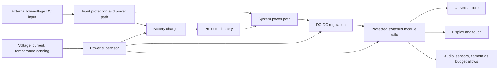
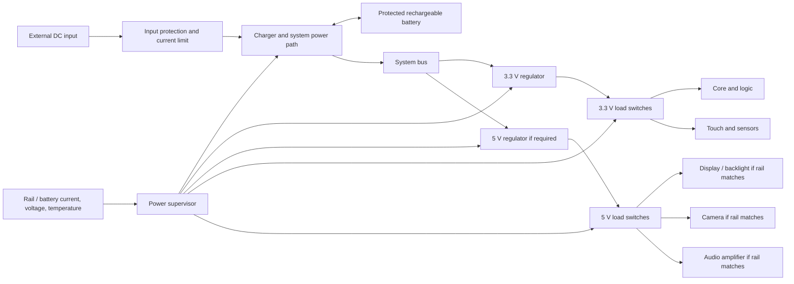

# Cornell Notes

## Topic: Industrial Electronics for Mechatronics — Learning and Desk-Clock Design Roadmap

## Date: 15/10/2026

---

<strong><em>"LEARN THE CONVERTER — THEN DESIGN THE MODULE"</em></strong>

---

### Cue Column (Questions, Keywords, or Prompts)

| Questions / keywords | Where to look in the notes |
| --- | --- |
| What is the end goal of studying this course alongside the product? | I.1: Parallel-learning method |
| Which desk-clock module is the main product thread? | I.2: Smart Power Dock |
| What do I study and design in Chapter 1? | I.3.1: Foundations and power budget |
| How do semiconductor characteristics affect my design? | I.3.2: Power devices and protection |
| Where can I apply AC switching and thyristors? | I.3.3: AC power control demonstrator |
| How do phase angle and rectifier pulse count change the output? | I.3.4: Rectifier demonstrator |
| Which course chapter most directly powers the clock? | I.3.5: DC-DC converters and power dock |
| What should I build to understand forward and flyback converters? | I.3.5: Isolated-converter study models |
| Why study current-source and voltage-source inverters? | I.3.6: Inverter and frequency-conversion demonstrator |
| What should be included in each chapter's deliverable? | I.4: Evidence package |
| In what order should I design and integrate the real module? | I.5: Project sequence and decision gates |
| Which product requirements are still unknown? | I.6: Open inputs and design cautions |
| How will I know the roadmap is complete? | I.7: Completion checklist |

---

### Notes Section (Main Notes)

**Primary course source:** [ME4084 Industrial Electronics for Mechatronics System syllabus](../03_resources/01_Syllabus-Industrial-Electronics-For-Mechatronics-System.pdf), especially course outcomes and weeks 1–15 in section 6. The chapter sequence below follows that syllabus and the six Huỳnh Văn Kiểm lecture handouts in `../03_resources/07_Dien-Tu-Cong-Suat-Huynh-Van-Kiem/`.

**Related notes:** [Chapter 1 — Introduction to Power Electronics](07_Dien-Tu-Cong-Suat-Huynh-Van-Kiem/01_chapter_01.md) expands the fundamentals in this roadmap. This document is a course-to-project plan, not a replacement for chapter notes or a validated circuit specification.

#### I.1. Parallel-learning method

Study each theory chapter and produce a small design artifact that demonstrates its ideas. Maintain two connected tracks:

1. **Course track:** derive circuit behavior, solve representative problems, simulate waveforms, and explain device/converter limits.
2. **Product track:** apply the relevant learning to the modular desk clock's Smart Power Dock, recording which decisions are supported by analysis and which remain open.

The clock does not need every topology taught in the course. Use rectifier, AC-control, and inverter circuits as low-voltage simulations or isolated teaching demonstrators where they do not fit the USB-powered product. The product's central application thread is a battery-powered, regulated DC supply with charging, protection, measurement, and controlled distribution.

For every chapter, keep a short record of: (a) the circuit and assumptions, (b) hand calculations, (c) simulation schematic and waveforms, (d) comparison between calculation and simulation, and (e) one conclusion for the product or an explicit reason the topology is only a course demonstrator.

#### I.2. Product thread: Smart Power Dock

The module to develop alongside the course is the **Smart Power Dock** for the desk clock. Its intended functions are:

- accept external low-voltage DC power;
- charge and protect a rechargeable battery using a suitable charger and battery protection strategy;
- convert battery/system voltage to the rails required by the core and attached modules;
- measure key voltages, currents, and temperature;
- enable, limit, or shut down module power when needed.

Conceptual power flow:

This is a functional map only. Cell chemistry and capacity, input source, output rails, peak loads, connector limits, charge profile, and thermal limits must be selected before choosing final parts or publishing a production schematic.

#### I.3. Chapter-by-chapter roadmap

##### I.3.1. Chapter 1 — Introduction and analysis foundations (weeks 1–2)

**Study:** power conversion and control; linear versus switching power electronics; converter classes; ideal switch models; peak, average, and RMS quantities; waveforms, power, efficiency, ripple, and basic circuit analysis.

**Parallel product design:** build the first power budget for the desk clock. The budget is a table of *loads by rail and operating mode*, not one guessed current for the whole product. Begin with a candidate rail map; keep every voltage and current marked **TBD** until the display, processor, camera, speaker, and battery are selected. The example below uses hypothetical values only to demonstrate the arithmetic. It is not a component recommendation or a claim about the product's actual loads.

**Step 1 — define the rails and load groups.** Start with separate rows for every rail that may have a different voltage or enable control. For an initial worksheet, use these placeholders:

| Rail (example only) | Loads to account for | Information to collect |
| --- | --- | --- |
| 3.3 V logic | Core MCU/radio, display controller, touch controller, camera control, audio/sensor logic, supervisor | Active, sleep, transmit/processing current; startup and radio peaks; allowable voltage range |
| 5 V peripheral | Display/backlight if its chosen assembly needs 5 V, speaker amplifier, camera module if applicable | Brightness-dependent display current, audio average and short peak, camera operating modes, inrush |
| Battery/system rail | Charger power path, regulators, monitor, power switches | Battery voltage range, regulator efficiency, battery current limit, charging and system-load behavior |

The final design may use different rails. Do not add milliamps from different voltage rails as if they were interchangeable; calculate power first.

**Step 2 — describe realistic operating modes.** Record whether each load is off, asleep, idle, or active in each mode. Include simultaneous cases that can happen in use, especially display + camera + audio, and charging while the clock is operating.

| Mode | Core/display/touch | Audio | Camera/vision | Sensors | Charging/input |
| --- | --- | --- | --- | --- | --- |
| M0: clock idle | Display on at normal brightness; touch waiting; core in low-activity state | Off or listening, as designed | Off | Low-rate sensing or off | Unplugged or battery operation |
| M1: touch interaction | Display/touch active; core briefly busy | Usually off | Off | Normal | Unplugged or battery operation |
| M2: voice interaction | Display on; core processing and radio active if cloud service is used | Microphone and speaker path active | Off | Normal | Usually battery operation; test powered use too |
| M3: camera/gesture | Display on; vision/camera and core processing active | Off unless simultaneous use is supported | Active | Normal | Usually battery operation |
| M4: combined peak | Bright display + core/radio + audio output + camera if the product allows these together | Active | Active | Active | Also evaluate external power/charging if supported |
| M5: charging idle | Normal clock behavior while battery charges | Off or listening | Off | Low-rate | Input supplies system load and charger |
| M6: charging with activity | Selected active feature while charging | Depends on use | Depends on use | Active as needed | Input current limit may be shared between load and charge |

If two functions are mutually exclusive by product design, document the rule and omit their impossible combination. Otherwise include their coincident peaks; average-case savings do not prevent a short peak from triggering a regulator limit or brownout.

**Step 3 — fill average and peak current per rail.** For each mode, sum the module currents that draw from that rail. Use the selected component datasheet's maximum or mode-specific values, then replace assumptions with measurements on the prototype. Keep both *typical/expected* and *worst-case specified* values when the datasheet provides them.

| Rail | Mode | Loads included | Average current (mA) | Peak current (mA) | Evidence/status |
| --- | --- | --- | ---: | ---: | --- |
| 3.3 V | M0 idle | Core idle + display/touch control + sensors | TBD | TBD | Datasheets / measured |
| 3.3 V | M1 touch | Core active + display/touch control + sensors | TBD | TBD | Datasheets / measured |
| 3.3 V | M2 voice | Core/radio + audio control + sensors | TBD | TBD | Datasheets / measured |
| 3.3 V | M3 camera | Core/vision control + camera logic + sensors | TBD | TBD | Datasheets / measured |
| 3.3 V | M4 combined | All simultaneously enabled 3.3 V loads | TBD | TBD | Datasheets / measured |
| 5 V | M0/M1 | Display/backlight and any always-on 5 V loads | TBD | TBD | Display specification / measured |
| 5 V | M2 voice | Display + microphone preamp/amplifier + speaker amplifier | TBD | TBD | Audio data / measured |
| 5 V | M3 camera | Display + camera module | TBD | TBD | Camera/display data / measured |
| 5 V | M4 combined | All simultaneously enabled 5 V loads | TBD | TBD | Datasheets / measured |

For every entry, identify whether “peak” means a specified short pulse (and its duration), startup inrush, or a continuous maximum. Record duration because a 5 ms pulse and a 30 s load have different implications for capacitors, thermal limits, and battery sizing.

**Step 4 — calculate power before combining rails.** For one rail, use $P=VI$. For simultaneous loads on different rails, add watts:

$$
P_{\mathrm{loads}}=\sum_k V_k I_k,\qquad
I_{\mathrm{battery}}\approx\frac{P_{\mathrm{loads}}}{V_{\mathrm{battery}}\,\eta_{\mathrm{conversion}}}+I_{\mathrm{overhead}}
$$

Use the *lowest expected battery voltage* for a conservative battery-current estimate, and a realistic efficiency at that load. Include regulator and supervisor quiescent current. This estimate is for steady power; check transient peaks and each converter's input/output current limits separately.

**Worked arithmetic example — fictitious values:** suppose a hypothetical 3.3 V rail draws 0.20 A and a hypothetical 5 V rail draws 0.60 A at the same instant. The combined output power is $3.3\times0.20+5\times0.60=3.66$ W. If the battery is at 3.2 V and total conversion efficiency is assumed to be 85%, battery current is approximately $3.66/(3.2\times0.85)=1.35$ A, plus system overhead. All currents, voltage, and efficiency in this example are placeholders; replace them before sizing anything.

**Step 5 — estimate runtime from energy and the duty cycle.** For each mode, estimate hours per day, then calculate:

$$
E_{\mathrm{day}}=\sum_m P_{\mathrm{average},m}\,t_m,
\qquad
\text{ideal runtime (h)}\approx\frac{E_{\mathrm{usable\ battery}}\ (\mathrm{Wh})}{P_{\mathrm{average\ system}}\ (\mathrm{W})}
$$

Use usable battery energy after conversion losses and reserve limits, not just the cell's printed mAh. A mAh rating is tied to cell voltage; watt-hours let you compare it with loads on several rails. Add a usage-profile column with estimated hours/day for M0–M6, and later replace it with logged real use.

**Smart Power Dock block diagram — functional draft:**

The block diagram says what functions need to exist, not which IC implements them. A charger IC manages the battery charge/power-path function; a supervisor MCU can read telemetry and control permitted load switches. Keep battery protection independent of ordinary application firmware wherever the selected battery architecture requires it.

**What is known versus estimated:**

| Item | Current status | How to close it |
| --- | --- | --- |
| Product is a modular AI desk clock with core and replaceable modules | Known at concept level | Freeze which modules are in prototype 1 |
| Candidate modes: idle, touch, audio, camera, combined peak, charging | Planning assumptions | Confirm which concurrent modes are actually allowed |
| Rail voltages and which modules use each rail | Unknown/TBD | Select actual modules and read their electrical specifications |
| Average/peak module currents and peak duration | Unknown/TBD | Datasheet extraction, then measure rail current in each mode |
| Battery chemistry, cell count, capacity, charge limits | Unknown/TBD | Select a protected pack and follow its supplier requirements |
| Runtime target and daily mode duty cycle | Unknown/TBD | Set a user-facing target and measure representative usage |
| Converter efficiency, quiescent draw, thermal performance | Estimate until parts and board exist | Datasheet/model first; bench-test at low, typical, and peak load |
| Four-contact dock/pogo-pin current capacity | Unvalidated | Define contact assignment; measure resistance, heating, and hot-plug behavior |

Mark every worksheet number with a source tag: **K** = known from a selected part or measured hardware; **E** = engineering estimate with its assumption stated; **TBD** = not yet available. Do not report an estimate as a measured result.

**Deliverable:** annotated system power tree, completed operating-mode/load table with K/E/TBD tags, runtime assumptions, a glossary of electrical quantities, and a simple PSIM model of a source feeding a representative load. Calculate average and RMS current and compare them with simulated measurements.

**Product decision:** identify the rail with the highest power, the largest sustained current, and the worst coincident peak; these may be different rails/modes. Use that analysis to define converter and connector requirements. Do not select the battery or converter rating from guesses.

##### I.3.2. Chapter 2 — Power semiconductor devices (weeks 3–5)

**Study:** power diodes, thyristors/SCRs, power transistors, device characteristics and switching behavior, thermal limits, and converter/device protection.

**Parallel product design:** compare candidate switching devices for a low-voltage DC-DC stage and module load switch. Estimate conduction and switching loss from datasheet parameters, then consider heat flow, current limiting, reverse current, overvoltage, and short-circuit protection. Build a separate SCR/device-comparison simulation for course objectives.

**Deliverable:** device comparison table with voltage/current margin, drive requirements, estimated losses, thermal path, and protection needs; PSIM waveforms for diode, SCR, and transistor switching cases.

**Product decision:** identify which parts need the power stage, which provide protection, and which are suitable only for the AC-control/rectifier demonstrators. Device choice remains provisional until the load and battery envelope is measured or specified.

##### I.3.3. Chapter 3 — AC power control (weeks 6–7)

**Study:** AC switching circuits, on/off control, phase-angle control using thyristors, and zero-cross switching.

**Parallel design exercise:** create a **separate isolated, low-voltage AC demonstrator** in PSIM. Compare on/off (zero-cross) control with phase-angle control using a resistive load, then observe how an inductive load changes current and commutation. Mark firing angle, load voltage, load current, and switching events.

**Deliverable:** two simulation cases, annotated waveforms, and a short comparison of switching loss, harmonics, and load behavior. Explain why zero-cross switching reduces turn-on disturbance for suitable loads and why it does not give the same control range as phase-angle control.

**Product decision:** use this chapter to understand thyristor AC control. It does not belong in the clock's low-voltage USB battery path; retain it as a course demonstrator unless the product requirements later include an AC load.

##### I.3.4. Chapter 4 — Phase-controlled rectifiers (weeks 8–10)

**Study:** diode rectifiers, SCR phase-controlled rectifiers, firing-angle control, single- and multipulse circuits, device series/parallel connection, mixed diode/SCR bridges, reversible rectifiers, and SCR trigger circuits.

**Parallel design exercise:** simulate a diode bridge and controlled rectifier feeding R and RL loads. Sweep firing angle and record average output, RMS output, ripple, input/output current shape, and commutation. Compare 2-, 3-, and 6-pulse arrangements as the syllabus requires; explain their source/phase requirements rather than treating pulse count as arbitrary.

**Deliverable:** a rectifier comparison sheet with circuit diagrams, firing sequence, calculated and simulated averages, waveforms, and explanation of pulse count and ripple differences. Add a gate-pulse timing diagram for one SCR bridge.

**Product decision:** use the rectifiers to learn controlled AC-to-DC conversion. The desk clock is planned around a low-voltage DC input and battery charger, so a mains-frequency SCR rectifier is not part of the first power dock.

##### I.3.5. Chapter 5 — DC-DC converters: forward, flyback, and PWM (weeks 11–12)

**Study:** DC voltage conversion, forward and flyback topologies, PWM, switch turn-off, energy storage/transfer, continuous and discontinuous conduction where applicable, and the syllabus assignment about PWM motor control.

**Parallel product design:** this is the main circuit-design chapter for the Smart Power Dock. Begin with a **battery-to-provisional regulated rail converter feeding a dummy load**. First analyze a basic non-isolated buck or boost stage to learn duty cycle, inductor current, ripple, switch/diode stress, startup, and feedback. Then study the forward and flyback circuits separately to meet the course outcome; compare isolation, transformer energy transfer, reset/clamp requirements, output ripple, and control.

**Deliverable:** hand calculations and PSIM models for the selected buck/boost study stage plus forward and flyback examples. Include startup and load-step cases, switching waveforms, estimated losses, and a topology comparison. Draw a KiCad schematic only after the electrical requirements are stated; initially use a safe, low-voltage, current-limited bench source and dummy load.

**Product decision:** choose whether the first dock rail needs buck, boost, or another conversion from the confirmed battery voltage range and load rail. Forward/flyback study is required by the course, but the desk clock should use isolation only if its system requirements justify it. An integrated converter may be selected for the product after the switching behavior is understood.

##### I.3.6. Chapter 6 — Independent inverters and frequency conversion (weeks 13–15)

**Study:** inverter classification; current-source inverter (CSI), voltage-source inverter (VSI), output-voltage control, harmonics, inverter control, and frequency conversion.

**Parallel design exercise:** simulate a VSI H-bridge with an R-L load and PWM output. Observe switching states, dead time, output fundamental, filtering, and harmonic content. Separately inspect a CSI model and compare its DC-side energy source and current behavior with the VSI. Extend the study to a variable-frequency motor/load model if time allows.

**Deliverable:** CSI/VSI block and circuit comparison, annotated switching and output waveforms, harmonic analysis before/after filtering or modulation changes, and a short explanation of how output frequency is controlled.

**Product decision:** inverter/VFD theory is relevant to future mechatronic hosts such as a mobile robot or motor accessory. The desk clock itself has no inverter requirement; keep these as simulations or a separate low-voltage motor-control demonstrator.

#### I.4. Evidence package for each chapter

Use the same compact package so theory work remains comparable across chapters:

1. **Concept page:** objective, topology, assumptions, device states, and expected current paths.
2. **Calculation page:** equations, selected operating points, ratings, and hand-calculated results.
3. **Simulation:** editable schematic, solver/time-step notes, labeled traces, and at least one startup or operating-point case.
4. **Comparison:** table of calculated and simulated quantities with percent difference where meaningful; explain model limitations.
5. **Product link:** one design decision supported by the chapter, or a note that this topology remains a course-only exercise.
6. **Communication:** a short diagram and explanation that can be presented to a teammate or instructor.

The syllabus names OrCAD, PSpice, Electronics Workbench, and Proteus as examples. PSIM can be used for the same learning purpose if available; the required evidence is the circuit behavior and analysis, not a specific brand of simulator.

#### I.5. Recommended project sequence

| Stage | Work | Exit evidence |
| --- | --- | --- |
| 1. Requirements | List input source, battery candidate, system rails, module modes, peak/average loads, connector and thermal constraints. Mark unknowns. | Reviewed power budget and requirements table |
| 2. Foundations | Complete Chapter 1 analysis; create the system power tree and load model. | Consistent average/RMS/current assumptions |
| 3. Device literacy | Complete Chapter 2 device/loss/protection comparison. | Preliminary switch and protection criteria |
| 4. Course demonstrators | Simulate Chapter 3 AC control and Chapter 4 rectifiers with suitable isolated low-voltage sources. | Reproducible waveforms and chapter comparisons |
| 5. Product converter | Analyze and simulate the battery-to-rail DC-DC stage with dummy load; study forward/flyback separately. | Chosen topology supported by requirements and results |
| 6. Schematic prototype | Translate the selected low-voltage power path into a KiCad schematic, including charger, protection, measurement, regulation, and load switching as justified. | Reviewable schematic and component ratings; no assumption that schematic alone proves hardware safety |
| 7. Bench validation | Bring up from a current-limited supply, check startup, load steps, temperature, fault response, and measured efficiency. | Recorded test conditions and measured results |
| 8. Integration | Connect the dock to core and display after rail/current limits and interface pins are defined. | Verified module-level power behavior |
| 9. Advanced course thread | Complete CSI/VSI and frequency-conversion simulations; relate to future robot/motor host. | Chapter 6 report/presentation |

#### I.6. Open inputs and design cautions

The following are **not yet fixed design requirements**: battery chemistry and cell count, capacity, charge current, input source/connector, all rail voltages, continuous and peak current per module, permitted ripple, standby target, run-time target, acceptable temperature rise, and whether any module requires isolation.

Before ordering parts or manufacturing a PCB:

- create a mode-by-mode power budget, including radio, display brightness, camera, audio, and startup peaks where present;
- confirm the battery pack's protection, temperature-sensing, and charging requirements from its manufacturer;
- check converter input/output range, peak current, ripple, startup, stability, thermal limits, and fault behavior using the current datasheet and reference design;
- budget connector contact resistance and current, and validate pogo-pin hot-plug behavior and signal integrity separately;
- keep mains and high-voltage AC out of early desk-clock prototypes; use simulation or appropriately isolated, current-limited low-voltage lab setups for AC-control theory.

Part numbers and component values should be recorded only after checking the selected datasheet, reference schematic, and actual load. A simulation passing does not establish hardware thermal, safety, EMI, or connector performance.

#### I.7. Completion checklist

- [ ] Chapter 1: explain converter classes and calculate average/RMS/power for a stated load profile.
- [ ] Chapter 2: compare diode, SCR, and transistor behavior; estimate loss and protection needs.
- [ ] Chapter 3: explain and simulate on/off and phase-angle AC control, including zero-cross behavior.
- [ ] Chapter 4: explain and simulate uncontrolled and controlled rectification, firing angle, and pulse count.
- [ ] Chapter 5: analyze forward and flyback converters and complete a requirements-based DC-DC stage study.
- [ ] Chapter 6: explain CSI/VSI differences, inverter output control, harmonics, and frequency conversion.
- [ ] Smart Power Dock: maintain a traceable power budget, block diagram, simulation evidence, schematic, and bench results.
- [ ] Presentation: show assumptions, results, limitations, and each teammate's contribution.

---

### Summary Section (Summary of Notes)

Follow the syllabus through six chapters while carrying one practical product thread: the modular desk clock's Smart Power Dock. Chapters 1 and 2 establish the power budget, switching behavior, device loss, thermal limits, and protection. Chapters 3 and 4 become isolated low-voltage or simulated AC-control and rectifier demonstrators. Chapter 5 directly supports the battery-to-regulated-rail converter and requires separate study of forward and flyback topologies. Chapter 6 develops CSI, VSI, harmonic, and frequency-conversion understanding for future motorized products.

The first product milestone is a requirements-based low-voltage DC-DC converter simulation feeding a dummy load, followed by a reviewable KiCad power-path schematic and current-limited bench validation. Charger, battery, rails, component values, connector limits, and loads remain open until the power budget and module requirements are known. Keep calculations, simulations, measurements, and product decisions linked, and label course-only circuits clearly.
